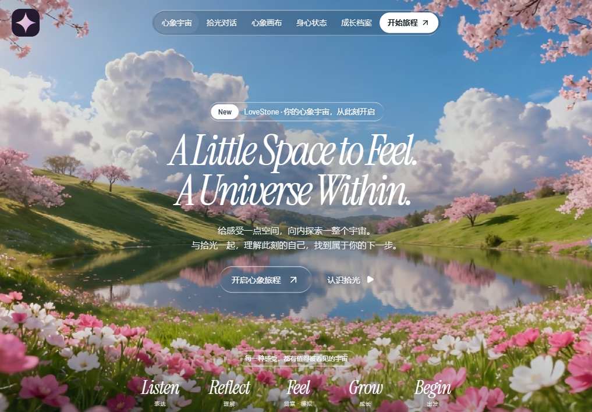

# 清华-腾讯S-Makers向善创客计划青少年心理平台\*翎语

  
  &nbsp;&nbsp;
  

> 这个世界从不缺少问题，缺少的是愿意用最好的工具去解决它们的优秀人才。

## 产品与演示范围

LoveStone 是面向个人的情绪支持 Agent。心象宇宙把一次支持对话做成可回看的经历：用户说出发生了什么，与角色「拾光」一起核对理解，选择接下来想怎么照顾自己，再决定要不要留下一张经历卡。AI 理解是可以纠正的假设，不是诊断。

## 持续后端支持流程（2026-11-05）

已整合模块 1—8、电影感前端、语音输入和共享调用调度。新增“后端支持流程”：一段旅程保持同一会话，接通模拟设备导入、独立用途授权、趋势与基线、理解纠正和版本确认、结构化支持路线，以及显式业务保存/恢复。

无模型 Key 的完整演示：后端设置 `PSYCHOLOGY_ENABLED=true PSYCHOLOGY_DEMO_MODE=true`，前端设置 `LOVESTONE_AGENT_API_URL=http://127.0.0.1:8000`。页面明确显示固定脚本模拟，工程通过不代表心理效果或专业审核通过。启动、接口与验收步骤见 [持续支持流程](docs/frontend-support-integration.md)，保存边界见 [业务存档 v2](docs/business-archives.md)。

## 运行前端演示

在仓库根目录执行（需要 Node.js 22 或以上，建议使用受支持的 LTS 版本）：

~~~powershell
cd frontend
npm ci
npm run dev
~~~

打开 [http://127.0.0.1:3000](http://127.0.0.1:3000)。默认演示不需要启动 Python 服务，也不需要 API Key。

1. 从心象宇宙首页选「开启心象旅程」，点「使用虚构示例」，再点输入框右侧箭头（生成理解草稿）。
2. 在对话页编辑事实、解释、情绪或需要，再点「确认当前理解」；也可去心象画布逐层回看。
3. 选择 Keep（留下）、Release（放下）或 Next（向前），主动「保存经历卡」；到成长档案检查结果。

个人状态页展示明确标注的模拟可穿戴趋势。CaseForge 是独立的内部研发评测视图。演示仅用虚构输入；不要录入真实敏感资料。真实聊天联调（可选）、数据边界、现有 API 和后续接口见[前端产品与联调说明](docs/frontend-product.md)。

首页和四个用户内页各有独立的电影感场景：暗色拾光对话、明亮心象画布、六段式身心状态、星空成长档案。支持背景暂停、逐词渐显、滚动揭示、理解层切换、交互趋势与卡片展开；移动端使用折叠导航。系统减少动态效果时保留静态呈现。外部视频加载期间或失败时显示本地海报；演示逻辑可离线运行。

在 `frontend/` 运行 `npm run typecheck`、`npm test`、`npm run build` 验证前端。下文保留现有 Python 运行、测试与评测入口。

## Personal Emotional Agent 后端

面向团队比赛项目的 Agent 运行框架，提供文字与语音输入、会话管理、可纠正草稿和工程评测能力。

## 开发进度

更新时间为 **2026-11-05**，当前版本为 **Runtime 0.7.0**。

| 模块 | 状态 | 已交付内容 |
|---|---|---|
| 心象宇宙前端 | 演示已完成 | 电影感首页、拾光对话、可纠正的心象画布、模拟趋势、成长卡片与内部评测视图；心理结构化流程仍为明确标注的本地演示 |
| 文字聊天 | 已完成 | DeepSeek API、多轮上下文、终端聊天与 FastAPI 消息接口 |
| 会话与运行控制 | 已完成 | 创建、切换、结束、清空，执行状态、暂停确认演示、取消、超时、预算与请求去重 |
| 通用草稿 | 已完成 | 创建、编辑、拒绝、按版本确认，纠正后旧确认失效 |
| 上下文与来源 | 已完成 | 使用当前有效草稿，记录来源，排除依赖已作废草稿的旧回复 |
| 离线工程评测 | 已完成 | 14 条工程案例、批量运行、版本与环境记录、脱敏报告 |
| 本地保存与恢复 | 已完成 | 用户主动保存 SQLite 快照，支持恢复、删除、版本冲突检查与旧请求阻止重放 |
| 语音输入 | 已完成 | 浏览器录音、腾讯云 ASR、模拟流程、转写校对后发送，支持取消、去重与短期缓存清理 |
| 外部调用调度与预算 | 已完成 | DeepSeek 与 ASR 共享总并发，有限队列、供应商限额、排队与执行总时限、取消及脱敏用量统计 |
| 心理模块接口 | 工程接入完成，专业审核待完成 | 严格结构化输入输出、来源检查、四路线与独立故障通知；unreviewed |
| 心理业务流程 | 后端闭环已接入 | 支持回复、理解编辑/确认、跨轮纠正、撤回失效与取消；正式四栏、完整角色动作及专业审核待完成 |
| 穿戴及业务存档 | 模拟接入完成 | 30 指标契约、可复现模拟、用途授权、基线/趋势、显式 v2 保存与恢复；真实设备、案例引擎与独立效果评测待接 |

业务状态当前保持 INITIAL。通用草稿使用 title/items 示例，正式心理字段和处理路线以团队确认版本接入。
当前服务适用于本机单用户开发，多用户身份认证与记录归属检查待实现。

## 最近交付与验证

- **2026-11-05 · 持续支持流程与模块 8**。后端 **615 项测试通过**；前端新增持续会话、结构化结果、授权设备趋势与理解确认。真实模型和设备调用为零；固定脚本浏览器联调与构建验证另见 [协作说明](docs/frontend-support-integration.md)。

- **2026-11-04 · 翎语前端同步**。合入已完成的 Next.js 演示与品牌资料，保留 Runtime 0.6.0 的语音和调用调度。前端构建、类型检查与 8 项测试已通过；合并后重新运行后端 237 项测试及 14/14 离线工程评测，全部通过，未调用真实模型。
- **2026-11-04 · 统一调用调度**。两类调用共享资源上限，支持有限排队、公平调度与取消。GET /runtime/calls 提供受控编号、耗时、供应商返回的 token 用量和输入音频时长。设计与配置见 [调用调度说明](docs/call-scheduler.md)。
- **2026-11-04 · 语音输入**。新增 /voice 页面及语音状态、转写和取消接口。腾讯云用约 6.9 秒的虚构合成音频完成真实识别。浏览器使用模拟麦克风验证录音、校对后发送、取消和聊天响应丢失后的去重重试，桌面与移动宽度布局检查通过。
- **2026-11-03 · 心理接口草案**。交付字段类型、引用规则、错误处理约定和两条虚构联调用例。心理路线、示例预期与正式集成仍待团队评审。

上游 2026-11-04 的完整回归为 **237 项测试通过**，包括语音测试 30 项和调用调度检查 22 项，另有 **14/14 工程评测通过**。
完整回归环境为 Windows / Python 3.13.5，新增语音测试也在 Python 3.12.13 通过。心理质量与专业安全效果等待相应业务评审和评测。

模块记录见 [开发步骤与进度](docs/development.md)，语音操作见 [语音输入说明](docs/voice-input.md)，心理对接见 [心理模块接口草案](docs/psychology-interface.md)。

## 首次运行（Windows PowerShell）

在克隆下来的项目文件夹打开终端。文件夹可以位于任意磁盘、使用任意名称，无需修改源码路径。
请先安装 Python；本项目最近验证环境为 Python 3.13。

~~~powershell
py -3.13 -m venv .venv
.\.venv\Scripts\python.exe -m pip install -r requirements.txt
.\.venv\Scripts\python.exe -B -m app.cli --demo
~~~

如果没有 py 启动器，可用对应 Python 解释器运行 python -m venv .venv。
依赖安装完成后，离线演示不需要 API Key。

## 配置真实聊天

仅当项目内还没有 .env 时，从模板创建配置（已有 .env 时跳过复制，避免覆盖 Key）：

~~~powershell
Copy-Item .env.example .env
~~~

在本地 .env 的 DEEPSEEK_API_KEY 后填写自己的 Key，或用交互输入：

~~~powershell
.\.venv\Scripts\python.exe -B -m app.cli --configure
.\.venv\Scripts\python.exe -B -m app.cli
~~~

Key 只保存在本地。配置不上传仓库，不把 Key 放进命令参数或共享文档。
--check 仅检查配置是否存在，不代表认证、额度或服务已验证。

## 常用命令

在项目根目录运行：

~~~powershell
.\.venv\Scripts\python.exe -B -m app.cli --offline
.\.venv\Scripts\python.exe -B -m app.cli --draft-demo
.\.venv\Scripts\python.exe -B -m app.cli --context-demo
.\.venv\Scripts\python.exe -B -m app.cli --archive-demo
.\.venv\Scripts\python.exe -B -m app.evaluation
.\.venv\Scripts\python.exe -B -m pytest -q -p no:cacheprovider
.\.venv\Scripts\python.exe -B -m uvicorn app.main:app --reload --host 127.0.0.1 --port 8000
~~~

API 文档：[http://127.0.0.1:8000/docs](http://127.0.0.1:8000/docs)。已有服务时不用重复启动。
语音页面：[http://localhost:8000/voice](http://localhost:8000/voice)。支持模拟流程和腾讯云真实转写，文字校对后发送。
录音、配置与接口见 [语音输入说明](docs/voice-input.md)。
Windows 也可用 .\dev.ps1 -Mode demo / chat / api / test / eval / archive-demo / check / setup。
若 PowerShell 限制执行脚本，直接使用上面的 Python 命令。

macOS/Linux 对应使用 python3 创建虚拟环境，并将解释器路径替换成 .venv/bin/python。
本轮未在 macOS/Linux 上验证。

## 聊天中的操作

- /new、/sessions、/use 编号前缀：新建、查看与切换会话。
- /history、/status、/context、/events：查看历史与运行元数据。
- /demo、/confirm、/cancel：演示流程的等待、确认与取消。
- /draft-new 标题、/draft-edit 标题、/draft-confirm、/draft-reject：通用草稿操作。
- /save、/archives、/restore 编号前缀：主动保存、列出和恢复。
- /save 存档版本：更新快照；/archive-delete 编号前缀 存档版本：删除快照。
- /clear 清空当前内存，磁盘存档保留；/end 结束；/exit 退出。

完整命令见 /help。修改代码后需重新打开终端聊天。

## 路径与个人配置

| 内容 | 默认位置 |
|---|---|
| API Key 与模型配置 | 项目根目录 .env |
| 评测案例 | evaluation/cases/runtime_v1.json |
| 评测报告 | 项目根目录 reports/ |
| 主动保存的会话 | data/session-archives.sqlite3 |
| 团队说明 | docs/ |

以上位置随项目移动。会话默认内存，只有主动保存才写入数据库。
启动或只列出空存档不创建数据库。恢复不重放旧请求，不恢复旧确认凭据。
当前接口用于本机单用户开发，尚未实现多用户身份认证；本地存档为明文文件。

需要把报告放入自己的笔记目录时，复制 local.paths.example.json 为 local.paths.json，
设置 evaluation_output_dir 为个人路径。相对路径以项目根目录为基准。
local.paths.json 已被 Git 忽略，不会把个人路径带给队友。
harness_note 仅供本机开发者定位原始研究笔记，程序不执行其中内容。

报告路径优先级：命令 --output > local.paths.json > 项目 reports/。

~~~powershell
.\.venv\Scripts\python.exe -B -m app.evaluation --output ./reports
~~~

离线评测不读取 .env，不访问模型服务。仓库忽略 .env、.venv、个人路径文件、报告和本地数据库。
默认本机笔记配置不会随克隆传播。

## 项目说明

docs/ 是随代码共享的阅读快照，更新文档时同步相关共享文件，不默认发布个人笔记或本地评测产物。

- [运行契约](docs/runtime-contract.md)
- [Harness 迁移原则](docs/harness-transfer.md)
- [模块进度与开发步骤](docs/development.md)
- [草稿版本管理](docs/草稿版本管理.md)
- [上下文来源](docs/上下文组装与来源记录.md)
- [离线评测](docs/批量评测运行器.md)
- [会话保存恢复](docs/会话保存与恢复.md)
- [开发约定](AGENTS.md)
- [心理模块接口草案与 JSON 示例](docs/psychology-interface.md)

## 个人支持流程（模块 7）

运行 `.venv/bin/python -B -m app.support_cli` 可离线演示模拟设备 → 分析 → 用户纠正 → 后续理解 → 撤回后旧结果失效。无真实模型调用。

服务端设置 `PSYCHOLOGY_ENABLED=true` 可让现有消息 API 使用结构化心理流程；默认保留普通聊天。心理策略仍为 unreviewed。接口、来源失效和暂不支持 v1 业务存档的边界见 [主流程集成](docs/agent-support-integration.md)。
