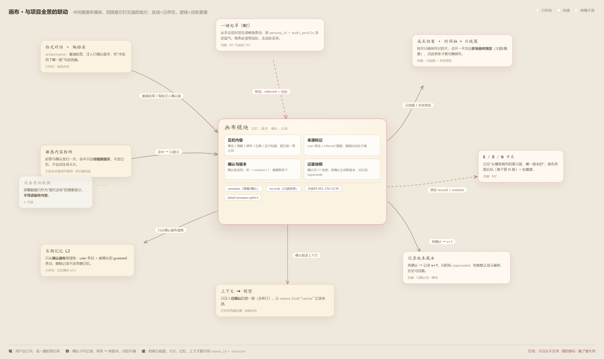
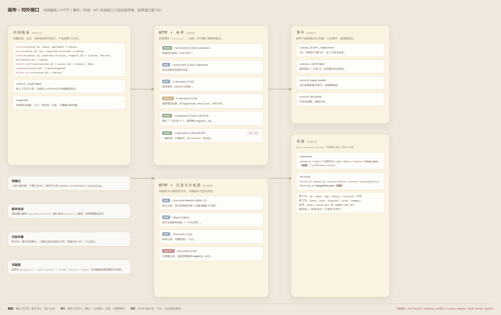
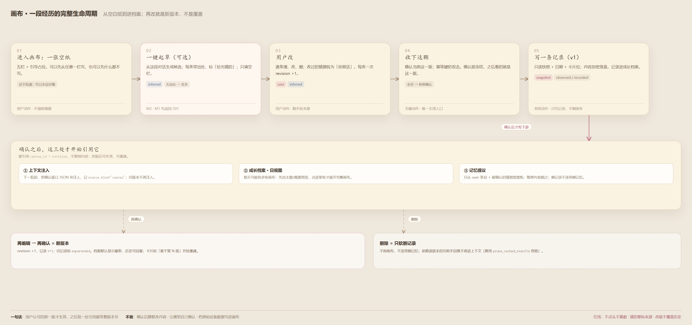

# 画布模块设计（v0.7）

状态：M1 已实现（2026-11-18，后端 694 项测试通过；起草/卡片/导出仍为 501 预留）
范围：M1 = 画布对象 + 确认 → 写一条 L1 记录；不包含 LLM 自动提议、KRN 卡片、按月档案。
关系：[长期记忆设计](long-term-memory.md) 是派上层；本文讲被派生的那份"原始理解"。

---

## 三分钟看懂

**画布 = 用户确认过的那段经历的结构化理解，带版本。**

一句话把三件事串起来：

> 对话里拾光猜了一版 → 用户改 → 用户点「收下这颗」→ 这版就冻结成**记录**（进成长档案）；
> 之后写卡片、生成档案、提议长期记忆，引用的都是这一版的 **canvas_id + revision**。

画布不是画画的地方，也不是自由白板。它是一份**双方都认过的理解**，五个格子：

```
事实 / 我如何理解 / 感受 / 我在意什么 / 还有哪些不知道
```

最后一格是留白，可以永远空着——空着也是有效信息。

---

## 一、长期记忆是什么（小结）

### 1.1 两层

| 层 | 名字 | 存什么 | 活多久 | 怎么用 |
|---|---|---|---|---|
| **L1** | 记录库（成长档案） | 用户确认过的"一天/一段经历"：画布快照 + 卡片 + 便签 | **不过期** | 按需调取，每轮最多 2 条 |
| **L2** | 便签 | 从记录里提炼的事、偏好、进行中的事、相处策略 | 有有效期 | 每轮注入，最多 3 条；与 L1 合计 ≤5 |

**画布是 L1 的上游**：没有确认的画布，就没有 L1 记录；没有 L1，就没有可信的 L2 素材。

### 1.2 L2 四类

| 类 | 例子 | 期限 |
|---|---|---|
| fact 事实 | 在读大三，住宿舍 | 长期 |
| preference 偏好 | 别问家里的事；不喜欢被叫"宝贝" | 长期 |
| context 进行中的事 | 这周在期末周，下周三结束 | 必带 `valid_to`，默认 30 天 |
| strategy 相处策略 | 先复述再说建议，TA 会更愿意说 | `review_at` 90 天 + 证据计数 |

### 1.3 作用与场景

| 场景 | 用到哪层 | 用户能感觉到的效果 |
|---|---|---|
| 隔了几天再打开 | L2 + L1 | "你上周在期末周吧"——不用从头说 |
| 问过的问题不再问 | L2 | 不再反复确认已知的事 |
| 提醒与关心 | L1 | "上次你说睡不好，现在呢" |
| 避免踩雷 | L2 preference | 不去碰明确说过别问的 |
| 拾光自己变好 | L2 strategy | 同一种回应方式被证明有效，下次多用 |

**边界**：不存原始聊天记录、不存设备原始数据、不做模型训练、不跨用户共享。

---

## 二、画布模块是什么

### 2.1 一句话定义

> 画布是**"模型对人的猜测"变成"用户认可的事实"的那道闸门**，并把这个结果锁定成可引用的版本。

**归属**：画布属于**这段经历**，不属于某一次会话。会话只是它被写出来的地方——隔天再打开对话接着聊，改的还是同一张画布。

它解决三个问题：

1. 模型猜的东西不能直接当真 → 必须用户确认；
2. 确认之后不能被后续对话悄悄改掉 → 必须版本化；
3. 卡片、档案、记忆都要引用同一份理解 → 必须有唯一 id + revision。

### 2.2 五栏

| key | 中文 | 谁写 | 能否空 | 说明 |
|---|---|---|---|---|
| `facts` | 事实 | 用户为主 | 能 | 发生了什么，尽量是原话 |
| `interpretation` | 我如何理解 | 模型猜 → 用户改 | 能 | 同一件事的不同读法 |
| `emotion` | 感受 | 用户 | 能 | 可以同时有好几种 |
| `needs` | 我在意什么 | 模型猜 → 用户确认 | 能 | 说不清就留白 |
| `unknown` | 还有哪些不知道 | 用户 | **能，且鼓励** | 明确保留不确定性，模型不许替用户填 |

每条内容都带 `source`：

| source | 含义 | 能不能变成记忆 |
|---|---|---|
| `user` | 用户原话或用户改过的 | 可以（用户可删） |
| `inferred` | 模型猜的 | **只有被用户确认过的条目才行** |

### 2.3 生命周期

```
draft ──用户编辑──> draft (revision+1)
  │
  └─确认「收下这颗」──> confirmed ──写一条 L1 记录──> 可被档案/卡片/记忆引用
             │
             └─再编辑──> draft (revision+1)  ← 旧的确认失效，需重新收下
```

关键规则：

- 只有 `confirmed` 的 revision 能进上下文；
- 编辑后确认失效（与现有草稿机制一致）；
- 确认幂等：同一 `expected_revision` + 同一 `request_id` 重复提交只产生一条记录；
- 记录保存的是**快照**，画布后来再改也不影响已存的档案；
- **再确认不覆盖旧记录**：同一天同一张画布再次确认 → 生成 **record v2**，旧记录标 `superseded`，档案默认只显示最新版，历史保留可回看（借鉴 Mem0 的写入裁决：新增 / 更新 / 无变化 / 作废，而不是直接改）。

### 2.4 两种起点：空白画布 + 一键起草

两者不是二选一，是**同一个画布的两种入口**：

```
进入画布
   │
   ├─ 默认：空白画布（五栏 + 引导占位，用户自己写）
   │        └─ 想省事：点右上角「一键起草」→ 从这段对话生成候选条目
   │
   └─ 起草结果同样是 draft，用户可逐条改/删/留
```

| 入口 | 用户看到 | 写入的内容 | 适合谁 |
|---|---|---|---|
| **空白画布** | 五栏 + 每栏一个引导问题和占位元素 | 只有用户自己写的 | 想自己梳理、或不太信任模型的人 |
| **一键起草** | 五栏被填上候选条目，标着「拾光猜的」 | `source=inferred`，未确认 | 不知道从哪写起的人 |

**空白画布上预置的占位元素**（不是内容，是提示，点了才变成一条）：

| 栏 | 引导问题 | 占位元素示例 |
|---|---|---|
| 事实 | 发生了什么？只写看见听见的 | 「今天最占心的一件事是…」 |
| 我如何理解 | 你当时怎么理解？还可能怎么理解 | 「我以为… / 也可能是…」 |
| 感受 | 哪些词贴近你的感受 | 慌 / 累 / 委屈 / 松一口气 |
| 我在意什么 | 此刻你希望得到什么 | 「想被说一句…」 |
| 还有哪些不知道 | 有什么还没想明白 | 「她为什么…」 |

### 2.5 起草的硬规则

1. **只填空栏**：起草默认只往空着的格子里放候选，用户已经写的不动；
2. **要覆盖先问**：五栏都非空时，按钮变成「重新起草（会覆盖你的内容）」，必须二次确认；
3. **候选必须可辨**：起草生成的每条都标 `source=inferred` + 界面「拾光猜的」标签，用户改过即转 `source=user`；
4. **不自动确认**：起草完停在 draft，必须用户自己点「收下这颗」；
5. **失败不破坏现场**：起草失败/超时就保留空白，给重试，不写半成品；
6. **无出处的猜测不填**：每条候选必须带 `origin`（会话里第几条消息）；拿不到出处的猜测直接丢弃，不写成条目（借鉴 Claude Code 计划里"每一步都有依据"的做法）。

**确认时，未被改动的 `inferred` 条目算什么？**
按"用户看着它点了收下"处理：画布确认 = 对**当前可见全部条目**的认可，所以 `inferred` 条目在整张画布被确认后可以进记录、也可以作为记忆素材（M2 的提议明确标注"经用户确认的猜测"）。想保留更强的控制，界面给逐条勾选，M1 先不做。

---

## 三、画布在哪里被用到

### 3.1 显式使用（用户看得见）

| 位置 | 用画布做什么 |
|---|---|
| 拾光对话 · 画布页 | 展示五栏、允许逐条改、点「收下这颗」 |
| K/R/N 三张卡 | 卡片绑定画布 revision；卡片上的"来源"指向画布某一格 |
| 成长档案 · 按月地图 | 每个节点 = 一条记录，点开 = 那天的画布 + 星图 |
| 档案 · 点开某天 | 直接渲染画布快照（只读）+ 当天卡片 |
| 设置页 · 我的记忆 | 记忆条目显示 `derived_from_record_id`，点进去是那天的画布 |

### 3.2 隐式使用（用户看不见）

| 位置 | 怎么用 |
|---|---|
| 上下文构建 | 当前会话最近确认的画布以 JSON 注入（只喂摘要，与现有草稿注入同一条通道） |
| 记忆提议 | 画布确认事件触发"候选记忆"生成（只从 `user` 条目 + 被确认的 `inferred` 条目出） |
| 提示语生成 | 读画布理解，生成卡片旁边的提示语（M2） |
| 档案摘要 | 生成"这一天存一页"的标题与一句话（M2） |
| 评测 | 离线评测核对"理解是否被用户改过"作为质量指标 |
| 删除与失效 | 删记录时，引用它的旧回复与旧记忆一并失效（复用现有 `prune_cached_results` 思路） |

### 3.3 明确不用画布的地方

- 首页、对话开场白（不需要结构）；
- 身心状态曲线（那是设备数据，画布只引用它的摘要）；
- 普通闲聊（没有"经历"时不该硬造画布）。

---

## 四、解耦关系

### 4.1 依赖方向

```
            schemas/canvas.py          ← 纯数据，不依赖任何模块
                    ↑
        services/canvas_store.py       ← SQLite，只懂画布表和记录表
                    ↑
        services/canvas_service.py     ← 业务规则（确认、版本、写记录）
                    ↑                      ↑
            api_canvas.py          agent/context.py（注入）
                    ↑                      ↑
             main.py               agent/orchestrator.py
```

**强制约束**：

- `canvas_service` 不 import session_service / orchestrator / psychology；
- 会话是否存在由 **API 层**校验，service 只收 `session_id: str`；
- 画布不主动调用记忆模块，只**发事件**（`canvas.confirmed`），由上层决定要不要提议记忆；
- 记忆模块不反向依赖画布表，只存 `derived_from_record_id` 这种弱引用。

### 4.2 它不做什么

- 不管对话、不调模型、不判安全路线；
- 不生成卡片（卡片是另一个对象，引用画布）；
- 不做档案的按月聚合（那是档案服务）；
- 不做分享/导出格式（二期）。

---

## 五、对外接口

### 5.1 内部服务（给其他模块用）

```python
canvas_service.create(session_id, lanes, day=None) -> Canvas
canvas_service.patch(canvas_id, changes, expected_revision) -> Canvas
canvas_service.confirm(canvas_id, expected_revision) -> tuple[Canvas, Record]
canvas_service.get(canvas_id) -> Canvas
canvas_service.latest_confirmed(session_id) -> Canvas | None
canvas_service.snapshot(record_id) -> CanvasSnapshot  # 只读快照
canvas_service.delete_record(record_id) -> Record
```

原则：**窄接口**。上层拿到的是对象，不直接摸 SQLite。

### 5.2 HTTP

| 方法 | 路径 | 说明 |
|---|---|---|
| POST | `/sessions/{session_id}/canvases` | 新建一版草稿（可由前端或对话流调用） |
| GET | `/sessions/{session_id}/canvases` | 该会话的画布列表（含状态） |
| GET | `/canvases/{canvas_id}` | 单张画布 |
| PATCH | `/canvases/{canvas_id}` | 改某一栏/某一条，需 `expected_revision` |
| POST | `/canvases/{canvas_id}/confirm` | 确认 → 写记录，幂等 |
| POST | `/canvases/{canvas_id}/draft` | **一键起草**：从本会话对话生成候选条目（M2 实现；M1 返回 501，前端可先接按钮） |
| GET | `/records?month=2026-11` | 按月取记录（档案首页用） |
| GET | `/records/{record_id}` | 单天记录（含画布快照） |
| DELETE | `/records/{record_id}` | 软删；返回被影响的记忆引用 |

错误码沿用现有风格：`canvas_not_found` / `canvas_revision_conflict` / `canvas_empty`（确认时全空）/ `canvas_not_editable`（已确认且不允许直改）。

### 5.3 事件

| 事件 | 载荷 | 谁听 |
|---|---|---|
| `canvas.draft_completed` | canvas_id, revision, filled_lanes, dropped_no_origin | 界面刷新（M2） |
| `canvas.confirmed` | canvas_id, revision, record_id, session_id | 记忆提议（M2）、档案刷新 |
| `record.superseded` | record_id, new_record_id | 档案刷新、旧回复失效 |
| `record.deleted` | record_id | 上下文失效、记忆弱引用清理 |

### 5.4 预留（先 501）

- `POST /canvases/{id}/draft`：一键起草（M2，需要模型与提示词版本）；
- `POST /canvases/{id}/propose`：从对话自动起草的旧命名，合并进 `draft`；
- `POST /canvases/{id}/cards`：生成 K/R/N（M2）；
- `POST /records/{id}/append`：给某天补一句"后来"（M1 末尾可做）；
- `GET /canvases/{id}/export`：导出 markdown。

---

## 六、业界怎么设计"可编辑的中间产物"

我们关心的不是"白板画布"（Figma/Notion），而是**Agent 先提议、人改完再确认、确认后冻结成可引用版本**这个模式。

| 项目/产品 | 它的"画布"是什么 | 可迁移的做法 |
|---|---|---|
| **Claude Code** | Plan 模式：只读探索 → 写计划文件 → 用户批准后才动手；TodoWrite 维护步骤；CLAUDE.md 作为持久约定 | **提议与执行分离** + 计划落文件（可回看）+ 显式批准 |
| **DSH**（本机运行的 Agent） | goal / todo / 任务板：任务有 owner、revision、CAS 更新；workflow 脚本是编排产物 | **revision + CAS**（我们确认时用 `expected_revision`）+ 产物可被多个模块引用 |
| **CoALA** | 工作记忆（当前推理草稿）+ 长期记忆（语义/情节/程序） | 明确区分"当场推理的草稿"和"沉淀下来的记忆"——画布正好是两者之间的桥 |
| **MemGPT / Letta** | Core memory blocks：小块、可被人和模型共同编辑、始终在上下文里 | 小块 + 可编辑 + 始终注入；我们更保守：**必须用户确认**才注入 |
| **GitHub Copilot Workspace** | Spec → Plan → Implementation，每步是可编辑产物，人审查后才生成代码 | 分阶段产物 + 人在环 |
| **OpenHands / Devin** | 任务计划、microagent、记忆文件 | 计划可读、可改、可重放 |
| **Generative Agents** | memory stream + 定期 reflection（把零散记忆总结成高层判断） | "反思"这个动作值得借鉴，但**反思结果不能默认当真**——我们要求用户确认，这正是画布的定位 |

### 共同模式（我们取的三条）

1. **草稿与生效分离**：agent 产出永远是 draft，用户动作才让它生效；
2. **版本 + 并发检查**：确认/修改都带 revision，冲突就拒绝（Claude Code 的 plan 文件、DSH 的任务板、我们的草稿机制都是这个套路）；
3. **只引用 id + revision**：下游（卡片、档案、记忆、上下文）不复制内容，引用版本，失效可追溯。

### 我们不取的

- 无限自由画布（Notion/Figma 式）——难校验、难失效、手机上更糟；
- 让模型自己改已确认的理解——等于绕过用户；
- 用向量库存画布（M1 不需要，等条目上千再说）。

---

## 七、我们项目的画布核心

**一句话：画布是"人认同意的理解"的契约对象。**

三个不可让渡的设计：

1. **确认即冻结**：`confirmed` 的 revision 内容不可变，想改就产生新 revision；
2. **来源决定命运**：`inferred` 没被确认的条目，不能进记忆、不能进档案摘要；
3. **留白是内容**：`unknown` 可以为空、可以写"暂时不知道"，系统不许替用户补。

> 判断标准：任何功能要"用一下那段理解"时，问一句——**它引用的是哪个 canvas revision？** 答不上来就不该用。

---

## 八、针对性设计

### 8.1 数据模型

**canvases**

| 字段 | 类型 | 说明 |
|---|---|---|
| canvas_id | TEXT PK | `cv_` + 12 hex |
| owner_id | TEXT | 默认 `local`，账号系统预留 |
| schema_version | TEXT | `canvas.v1`，结构演进预留 |
| origin_session_id | TEXT | **第一次**在哪个会话里创建（溯源用，不限制后续修改） |
| day | TEXT | `YYYY-MM-DD`（Asia/Shanghai），记录归属哪一天 |
| status | TEXT | `draft` / `confirmed` / `deleted` |
| revision | INTEGER | 每次修改 +1 |
| lanes_json | TEXT（加密） | `{facts:[...], interpretation:[...], emotion:[...], needs:[...], unknown:[...]}` |
| note | TEXT NULL（加密） | 一句话概括（可空） |
| source | TEXT | `dialog` / `manual` / `import` |
| persona_id / draft_profile / prompt_version / model | TEXT NULL | 起草元数据，手填时为空（可复现） |
| sensitivity_json | TEXT NULL | `{level, categories}`，敏感提示用 |
| enc_key_id | TEXT | 密钥标识，默认 `k1`，轮换用 |
| merged_from_json | TEXT | `[]`，画布合并预留 |
| export_version | INTEGER | `1`，导出格式预留 |
| confirmed_revision | INTEGER NULL | 确认时的版本 |
| confirmed_at / created_at / updated_at / deleted_at | TEXT | ISO-8601 |

**entries（lanes 内的元素）**

| 字段 | 说明 |
|---|---|
| entry_id | `e_` + 8 hex |
| text | ≤200 字 |
| source | `user` / `inferred` |
| confirmed | bool，`inferred` 条目必须被勾选才能算数 |
| origin | `{message_index?, draft_id?}` 溯源 |
| risk_tags | `[]`，敏感类别（检测时写） |
| lang | 语言占位（默认 `zh`） |
| embedding_ref | `null`，向量检索预留 |

**records（L1）**

| 字段 | 说明 |
|---|---|
| record_id | `rec_` + 12 hex |
| owner_id / session_id / canvas_id | 归属与来源 |
| canvas_revision | 快照对应的确认版本 |
| **version** | 同一天同一画布的记录版本，从 1 起 |
| **superseded_by** | 被哪条新记录取代（`record_id`，可空） |
| **observed_at** | 这段经历**发生**的时间（用户可指定，默认当天） |
| **recorded_at** | 用户**确认**的时间（= created_at） |
| day | 档案按月用的日期（默认取 `observed_at`） |
| snapshot_json | 冻结的画布内容（只读） |
| cards_json | 当天卡片（M2 才有内容） |
| note / summary | 用户便签 / 生成的一句话（加密） |
| tags_json | `[]`，标签预留 |
| sensitivity_json | 敏感类别与等级 |
| export_version | 导出格式版本（默认 1） |
| enc_key_id | 密钥标识 |
| status | `saved` / `superseded` / `deleted` |
| created_at / deleted_at | |

> `observed_at` 与 `recorded_at` 分开，是为了"补一句后来"这类场景：经历发生在昨天，记录写于今天。参考 Zep/Graphiti 的双时间做法。

存储：`data/canvases.sqlite3`（两表 + 索引 `(owner_id, day)`、`(session_id, status)`）。
与记忆库分库：记忆是**派生数据**，画布/记录是**原始数据**，删记忆不该影响档案。

### 8.2 状态机与守卫

| 动作 | 前置 | 结果 |
|---|---|---|
| create | session 存在（API 层校验） | draft, revision=1 |
| patch | status=draft 或 confirmed 且带 `expected_revision` | revision+1；若原为 confirmed → 回到 draft，确认失效 |
| confirm | 至少一栏有非空内容（含 unknown） | confirmed，写新记录（v+1）；若同画布已有记录 → 旧记录标 `superseded` |
| confirm 重复 | 已确认且 revision 相同 + 同一 `request_id` | 幂等，返回同一条记录 |
| delete record | 记录存在 | 软删，返回受影响 `memory_refs` |
| 全部为空 | confirm 时 | 422 `canvas_empty` |
| 一键起草 | 画布为 draft；**该画布没有进行中的起草**（`drafting` 锁，60 秒超时自动释放） | 只填空栏；`inferred` 条目不覆盖用户内容；五栏全非空返回 409 `canvas_draft_needs_replace`，需带 `replace=true` |

### 8.3 与现有代码的接线

| 现有位置 | 改动 |
|---|---|
| `app/schemas/canvas.py` | 新增 |
| `app/services/canvas_store.py` | 新增（参照 memory_store 的写法：每次操作开关连接、只在写路径建表） |
| `app/services/canvas_service.py` | 新增 |
| `app/api_canvas.py` | 新增，`main.py` 里 include |
| `app/agent/context.py` | 已支持 `memories`；再加 `canvas: Canvas | None`，注入 JSON 与 `source.kind="canvas"`（与现有草稿注入同位置） |
| `app/services/session_service.py` | 记录 `turn_canvas_sources`（哪一轮用了哪个 revision，供失效） |
| `app/agent/orchestrator.py` | 普通链路取 `canvas_service.latest_confirmed(session)` 注入；心理链路接缝留到 M3 |
| `app/schemas/context.py` | `ContextSource.kind` 加 `canvas`；清单加 `canvas_reference` |

**兼容**：现有通用草稿（title/items）保留；心理模式四栏（facts/interpretation/emotion/needs）与画布五栏同 key，迁移时只需补 `unknown` 与 `source`。

### 8.4 配置

| 变量 | 默认 | 说明 |
|---|---|---|
| `CANVAS_ENABLED` | true | 关闭后接口 409，注入跳过 |
| `CANVAS_DB_PATH` | `data/canvases.sqlite3` | |
| `CANVAS_MAX_ENTRIES` | 5 / 栏 | 防刷 |
| `CANVAS_MAX_TEXT_CHARS` | 200 | 单条 |
| `CANVAS_MAX_TOTAL_CHARS` | 1200 | 整张画布总量，超了提示"挑重点" |
| `CANVAS_DRAFT_LOCK_SECONDS` | 60 | 一键起草的锁超时 |
| `CANVAS_DEFAULT_DAY` | 当天（Asia/Shanghai） | 二期允许补记某天 |
| `CANVAS_ENCRYPTION` | on | 内容列加密开关（见 8.6） |
| `CANVAS_KEY_PATH` | `data/.canvas.key` | 密钥文件；也可用 `CANVAS_ENC_KEY` 注入 |
| `CANVAS_DRAFT_PROFILE` | `shiguang` | 起草的角色设定（见 8.7） |
| `CANVAS_SENSITIVE_POLICY` | `warn` | `warn` 提示 / `block` 禁止生成卡片 |

### 8.5 质量指标（先埋点，不做看板）

画布好不好，不能靠感觉。确认流程里顺手记五个数：

| 指标 | 怎么算 | 看什么 |
|---|---|---|
| **起草采纳率** | 起草后保留到确认的 inferred 条目 / 起草总条数 | 模型猜得准不准 |
| **用户改写率** | 用户改过的条目 / 起草总条数 | 猜得越多改得越多，说明该少猜 |
| **留白率** | `unknown` 非空的画布 / 全部画布 | 产品敢不敢承认"不知道" |
| **确认率** | confirmed 画布 / 创建的画布 | 画布是不是太重 |
| **重起草率** | 同一画布起草 >=2 次的比例 | 第一次起草质量 |

埋点只写本地 JSON 日志，不传第三方；这两项（改写率、留白率）也是离线评测可以引用的指标。

### 8.6 加密落盘（v0.4 决定：要加密）

**威胁模型**（先写清楚，别过度承诺）：

| 威胁 | 明文 SQLite 的后果 | 加密后 |
|---|---|---|
| 笔记本丢失/磁盘被读 | 画布内容全部泄露 | 挡住（没有密钥） |
| 同机另一个系统账户读文件 | 泄露 | 挡住 |
| 备份/同步目录被拷走 | 泄露 | 挡住 |
| 攻击者拿到密钥文件或进程内存 | — | **挡不住**（本地应用无法对抗已控制系统的攻击者） |

**方案选择**（参考 Day One 的端到端加密与 local-first 项目的磁盘加密实践）：

| 方案 | 优点 | 缺点 | 结论 |
|---|---|---|---|
| SQLCipher（整库透明加密） | 全库 AES-256，索引照常 | Windows 上 `pysqlcipher3` 编译麻烦，驱动替换风险高 | ❌ 本项目不采用 |
| 应用层**内容列加密** | 纯 Python，`cryptography` 有现成 wheel；索引列保持明文 | 只能保护内容列，不能保护表结构/时间 | ✅ 采用 |
| 全盘加密（BitLocker/FileVault） | 零改动、挡住整盘丢失 | 要用户自己开 | 作为**基线建议**写进文档，不作为唯一手段 |

**具体做法**：

- 加密范围：`lanes_json`、`note`、`snapshot_json`、`cards_json`、`summary`（以及记忆库的 `text/summary`）；
- 明文列：`canvas_id / owner_id / day / status / revision / created_at`——这些是查询和索引需要的，本身不揭示内容；
- 算法：**AES-256-GCM**，每条记录独立随机 `nonce`，`aad` 绑定 `canvas_id + revision`（防重放/调包）；
- 密钥：首次启动生成 32 字节随机密钥，写入 `data/.canvas.key`（权限 600）；也支持 `CANVAS_ENC_KEY`（base64）注入，供部署环境用；
- 存储格式：`enc:v1:<base64(nonce+ct)>`，前缀便于将来换算法/密钥轮换；
- 迁移：启动时若发现明文旧行，读取时自动加密回写（一次性，带版本标记）；
- 缺失密钥时：**拒绝启动而非静默降级**——宁可起不来，也不明文落盘。

**明确不做**：端到端加密（没有服务器）、密钥派生自用户口令、硬件密钥（二期再谈）。

### 8.7 敏感内容（v0.4 决定：要提示）

参考心理健康产品的通行做法（危机检测**宁可多报不可漏报**，且可以覆盖任何对话路径）：

**三层，只做前两层，第三层只提示**：

| 层 | 做什么 | 落点 |
|---|---|---|
| 检测层 | 关键词/正则匹配：自伤、自杀、虐待、暴力、性侵、涉法 | 起草时 + 确认时各扫一次（<5ms） |
| 提示层 | 命中就在画布顶部出一条**非阻断**提示：「这段内容比较重，要不要先聊聊？可以找 XX 求助」+ 求助入口 | 界面 + 返回体 `sensitivity: {level, categories}` |
| 记忆层 | **敏感内容不进 L2 记忆、不自动生成卡片**（用户仍可手写卡片） | 记忆提议默认跳过 |

规则：

- 检测**不在客户端做**，也不把命中词写进日志（只记类别与数量，避免二次泄露）；
- 提示是**非阻断**的：用户仍可继续写、继续确认——这是 TA 的经历，不是我们的；
- `CANVAS_SENSITIVE_POLICY=block` 时，命中条目禁止生成卡片，但不禁止保存；
- 真正的安全响应仍走对话侧现有的 `clarify_safety / safety_support / urgent_real_world_help` 三条路线，画布只负责"不假装没看见"。

### 8.8 角色化起草（v0.4 决定：按角色设定）

起草的语气和人设由**角色档案**决定，而不是散在提示词里：

| 概念 | 说明 |
|---|---|
| `persona_id` | 画布记录是哪个人格起草的（默认 `shiguang`，拾光） |
| `draft_profile` | 提示词配置：五栏填写倾向、语气、长度、是否只用用户原话 |
| `prompt_version` | 写进起草元数据，保证可复现与可评测 |

要点（参考角色卡/人格提示的公开经验：**结构化利于记忆，散文利于语气**）：

- **结构固定**：五栏永远是五栏，角色只影响"怎么填"，不影响"填什么栏"；
- **语气用散文写、结构用字段约束**：风格段落放进系统提示，输出用 JSON Schema 约束；
- **可切换**：将来拾光有"温和版/直接版"等设定时，同一张画布可以由不同角色重新起草，但**覆盖前必须确认**（见 2.5 规则 2）；
- **可复现**：`drafted_by = {persona_id, draft_profile, prompt_version, model}` 存进画布/记录，出问题能回查。

### 8.9 预留（与《接口预留清单》对齐）

画布是第一个"从零建表"的新模块，**预留位在 M1 建表时一次带齐**，避免以后迁移：

| 类 | 预留 |
|---|---|
| 字段 | 见 8.1：`schema_version`、`persona_id/draft_profile/prompt_version/model`、`sensitivity_json`、`enc_key_id`、`merged_from_json`、`export_version`、`tags_json`、`embedding_ref` |
| 接口（先 501） | `POST /canvases/{id}/draft`、`POST /canvases/{id}/cards`、`POST /records/{id}/append`、`GET /canvases/{id}/export`、`GET /personas` |
| 分页 | 新列表接口统一接受 `?limit=&cursor=`；本期忽略 cursor、默认全量 |
| 健康检查 | `/health.modules` 输出 `{canvas, cards, memory, archive: enabled/disabled/reserved}` 与各自 `schema_version` |
| 事件入口 | 新增 `app/events.py`（同步内存版）：`publish/subscribe`，画布只发事件不 import 记忆/档案 |
| 迁移 | 三个库统一 `PRAGMA user_version` + `MIGRATIONS` 阶梯；不再只靠 `CREATE TABLE IF NOT EXISTS` |
| 密钥轮换 | 每条密文记 `enc_key_id`；换密钥时新旧共存、按 id 解密、后台重加密 |
| BFF | 前端加 `/api/canvas/*`、`/api/records/*`、`/api/memories/*` 转发 |

**规则**：预留位要么返回 501，要么默认关闭（`CARDS_ENABLED=false` 等），并在 `/health.modules` 里可见——不留"看着能用其实没实现"的接口。

---

## 九、M1 范围与验收

### 做（v0.4 调整：加密与日视图进 M1）

- **画布**：空白创建（允许全空）、读、改（跨会话可改，属"这段经历"）、确认（幂等键 + 版本冲突）；
- **记录**：确认时写入 v1，再确认生成 v+1 并把旧的标 `superseded`；软删只删记录；按月、按天取；
- **日视图**：`GET /days/{day}` 返回那天所有画布**预览**（主题/概要/时间/卡片数），点进去再拉完整画布；
- **加密**：内容列 AES-256-GCM，启动生成/读取密钥，缺密钥拒绝启动；迁移旧明文行；
- **敏感提示**：确认与起草时扫关键词，命中返回 `sensitivity` 与界面提示，不阻断；
- **上下文**：当前 owner 最近确认的画布注入（普通聊天链路）；
- **失效**：删记录后，依赖该 revision 的旧助手回复不再进上下文；
- **预留**：8.9 的字段、501 端点、分页参数、`/health.modules`、`app/events.py`、迁移器、`enc_key_id`；
- **测试**：约 45 项（状态机、幂等、裁决、加密往返、敏感、日视图、注入、失效、预留位、迁移、HTTP）。

### 不做

- 一键起草真实生成（`/draft` 返回 501，前端先接按钮）；
- KRN 卡片（M2）、月度反思（M3）、导出/分享/合并、多用户；
- 端到端加密、硬件密钥。

### 验收口径

1. `POST /canvases` → `PATCH` → `confirm` → `GET /records?month=` / `GET /days/{day}` 能取到；
2. 同一 `expected_revision + request_id` 重复 confirm 只出一条记录；
3. 改已确认画布再 confirm → record v2，旧记录 `superseded`，历史可查；
4. 用旧 revision 改 → 409；
5. 五栏全空时 confirm → 422；
6. 跨会话（同 owner）能继续改同一张画布；
7. 直接打开 SQLite 文件看不到明文内容（`strings` 搜不到原句）；
8. 敏感词命中时返回提示但不阻断保存；
9. 确认后的画布出现在下一轮上下文清单（`source.kind="canvas"`）；
10. 删除记录后，上一轮引用它的助手回复被排除；
11. `/health.modules.canvas.enabled` 与 `schema_version` 可读；预留端点返回 501；
12. 老库（无新字段）能通过迁移器打开，不丢数据；
13. 全部测试通过，不调用真实模型。

---

## 十、已定与仍未定

### 已定（v0.4）

| 项 | 决定 |
|---|---|
| 跨会话续写 | **画布属于这段经历**，不绑会话；会话只是来源 |
| 一天多张 | 允许；档案按时间轴，点开那天先出**多张预览**（主题/概要），点某张再看完整画布 |
| 删记录 | **只软删记录**，不削画布、不连带删记忆 |
| 敏感内容 | **要有提示**，非阻断；不进 L2 记忆、不自动生成卡片 |
| 明文落盘 | **加密**：内容列 AES-256-GCM，索引列明文 |
| 起草风格 | **按角色设定**（persona_id + draft_profile + prompt_version） |
| 再确认 | 不覆盖，生成 v+1 并 supersede 旧记录 |
| 卡片绑定旧 revision | 卡片保留并标"基于第 N 版"，给"按新版重建"；不自动改用户的东西 |
| 逐条确认 | M1 整张确认；M2 再讨论逐条 |

### 仍未定

| 项 | 说明 | 建议默认 |
|---|---|---|
| 账号与监护人 | 多用户、未成年人同意 | 保持 local，账号另开 |
| 保留期 | 画布/记录删了以后多久物理清除 | 墓碑 30 天，与记忆一致 |
| 现有 `draft(title/items)` 迁移 | 见附录 D；M1 并存 | 心理模式四栏可一键转画布 |
| 导出格式 | 稳定 JSON 结构 | M2 定，先用文档里的 schema |
| 多设备并发提示 | CAS 拒绝后的 UI 文案 | M2 |
| 月度反思 | 多记录提炼 | M3，同样需确认 |
| 起草提示词细节 | 五栏各自的措辞、长度 | M2 与前端一起调 |

### 二期及以后

| 项 | 说明 |
|---|---|
| 一键起草真实生成 | M2：schema 约束 + 一次修复重试 + 失败保留空白 |
| K/R/N 卡片对象 | M2，绑定 record_id + canvas_revision |
| "补一句后来" | M2，追加不覆盖，`observed_at` 不变 |
| 画布合并 | 暂不做，需人工规则 |
| 记忆提议接画布 | M2，只从 user 条目 + 被确认的 inferred 条目出 |
| 导出/分享 | M2+ |
| 账号 | `owner_id` 预留，跨用户访问 404 |

---

## 附录 A：一组示例 JSON

```json
{
  "canvas_id": "cv_9f2a1c3d4e5f",
  "session_id": "0b7c...",
  "day": "2026-11-13",
  "status": "confirmed",
  "revision": 3,
  "lanes": {
    "facts": [
      {"entry_id": "e_a1", "text": "期末周，复习到两点。", "source": "user", "confirmed": true},
      {"entry_id": "e_a2", "text": "室友说「你最近话好少」。", "source": "user", "confirmed": true}
    ],
    "interpretation": [
      {"entry_id": "e_b1", "text": "她大概是在担心我。", "source": "user", "confirmed": true}
    ],
    "emotion": [
      {"entry_id": "e_c1", "text": "慌，累，还有一点委屈。", "source": "user", "confirmed": true}
    ],
    "needs": [],
    "unknown": [
      {"entry_id": "e_e1", "text": "她为什么突然说那句话？", "source": "user", "confirmed": true}
    ]
  },
  "note": "停下来的那天"
}
```

## 附录 B：与长期记忆的边界

| 问题 | 画布 | 记忆 |
|---|---|---|
| 这段经历本身 | ✅ 存 | ❌ |
| 从经历里提炼的偏好 | ❌（只作为素材） | ✅ 存 |
| 用户可编辑 | ✅ 逐条 | ✅ 逐条 |
| 过期 | ❌ 不过期 | ✅ context 必带 `valid_to` |
| 进上下文 | 确认版才进 | 确认且未过期才进 |
| 删除影响 | 档案消失 | 记忆消失/失效 |

## 附录 C：判断"该不该动画布"的三问

1. 这件事是不是发生在**某一天/某一段经历**上？（不是 → 别用画布）
2. 用户有没有**改过并确认**？（没有 → 只是草稿，别写记录）
3. 下游引用的是**哪个 revision**？（答不上来 → 先别接）

---

## 附录 D：现有 `draft` 与"心理四栏"分别是什么

这两个名字来自现有代码，容易和画布混，单独说清。

### D.1 通用草稿 `Draft`（`app/schemas/draft.py`）

现在的草稿是一个**通用容器**：

```json
{"title": "DRAFT_A", "items": ["sample"]}
```

- 有 `draft_id`、`revision`、`status(proposed/confirmed/rejected)`、`confirmation_token`；
- 确认后，上下文构建会把确认版 JSON 塞进对话（`app/agent/context.py`）；
- 它**不认识"经历"这个概念**，内容形状由调用方随便填，所以在对话里更像"待确认的结构化数据"，不是可阅读的一页。

### D.2 心理四栏（`facts / interpretation / emotion / needs`）

心理模式（`PSYCHOLOGY_ENABLED=true`）有自己的四栏理解，前端也用这四个 key：

| 四栏 | 画布对应 | 差异 |
|---|---|---|
| facts | `facts` | 一致 |
| interpretation | `interpretation` | 一致 |
| emotion | `emotion` | 一致 |
| needs | `needs` | 一致 |
| —（无） | **`unknown`** | 画布新增：明确保留"还不知道" |

也就是说：**画布 ≈ 心理四栏 + 留白 + 来源 + 版本 + 确认后的记录**。四栏是"理解的内容"，画布是"理解的对象"。

### D.3 迁移关系（M1 并存，M2 合流）

| 现状 | 将来 | 时机 |
|---|---|---|
| 通用 `Draft(title/items)` | 保留，给非经历类数据用（测试、演示草稿） | 不动 |
| 心理模式四栏结果 | 由 adapter 映射成画布 `lanes`（补 `unknown`、补 `source`） | M2 |
| `confirmed_draft` 上下文注入 | 画布走同一条通道（`source.kind="canvas"`） | M1 并行 |
| 前端"四栏确认" | 变成画布页的一部分 | M2 |

**迁移只做加法**：现有接口不改，画布新增一层；等心理适配器能直接产出画布后，`confirmed_draft` 的注入自然废弃。

### D.4 "卡片绑定旧 revision"是什么意思

卡片（KRN）不是复制画布文字，而是记住：**"我是从哪张画布的哪一版、哪一格来的"**：

```json
{"card_id": "card_1", "record_id": "rec_a", "canvas_revision": 3,
 "source": {"lane": "facts", "entry_id": "e_a2"}}
```

之后用户回头改了画布，确认成第 4 版（新记录 v2），那张旧卡片还指着第 3 版。界面上就两种处理：

| 处理 | 表现 | 我们选 |
|---|---|---|
| 静默跟随 | 卡片自动变成第 4 版 | ❌ 用户会困惑"我没改它" |
| 标旧版 + 给重建 | 卡片上标「基于第 3 版」，旁边给「按新版重建」 | ✅ 默认这个 |

原则：**用户的东西不自动改**；版本差是事实，要显示出来。

---

## 附录 H：三张示意图

图在 `assets/diagrams/`，和正文对应关系如下。

**图 1 · 与项目全景的联动**（哪些实线已存在、哪些虚线要建）



**图 2 · 对外接口**（内部服务 / HTTP / 事件 / 存储与加密）



**图 3 · 一段经历的完整生命周期**（空白 → 起草 → 改 → 确认 → 记录 → 三处引用）



---

## 变更记录

- v0.7：M1 已实现（后端 `app/schemas/canvas.py`、`canvas_store/service.py`、`api_canvas.py`、事件总线、迁移器、加密）；694 项测试通过；起草/卡片/导出/「补一句」/personas 为 501。
- v0.6：按《接口预留清单》补齐预留位（8.9）：表字段、501 端点、分页参数、`/health.modules`、`app/events.py`、迁移器、`enc_key_id`、BFF 路径；M1 范围与验收同步更新。
- v0.5：补三张示意图（附录 H）；图在 `assets/diagrams/`。
- v0.4：定下跨会话归属、一天多张（日视图预览）、只软删记录、敏感提示、加密落盘（AES-256-GCM 方案对比）、角色化起草；新增 8.6/8.7/8.8、附录 D（现有 draft/四栏/卡片版本）。
- v0.3：加起草锁、确认幂等键、无出处不填；记录改为 v+1 + supersede；补 `observed_at/recorded_at`、质量指标、待定清单。
- v0.2：确定"空白画布 + 一键起草"共存；补 2.4/2.5（占位元素、起草硬规则）、`POST /canvases/{id}/draft`、起草守卫。
- v0.1：初稿（画布对象、五栏、记录、接口、M1 范围）。

写完之后要改什么，在文件末尾加一行版本记录即可；文件名不带日期。
