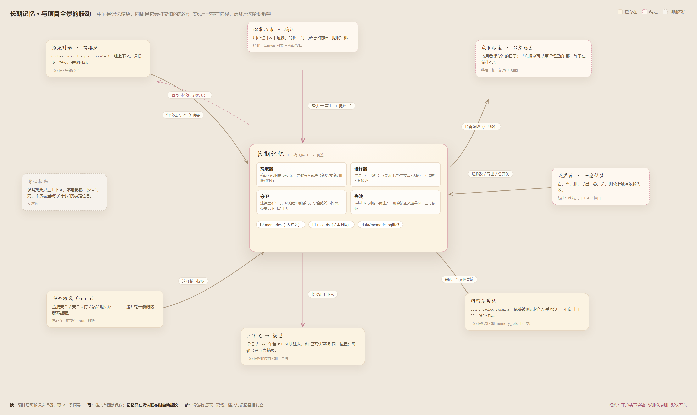
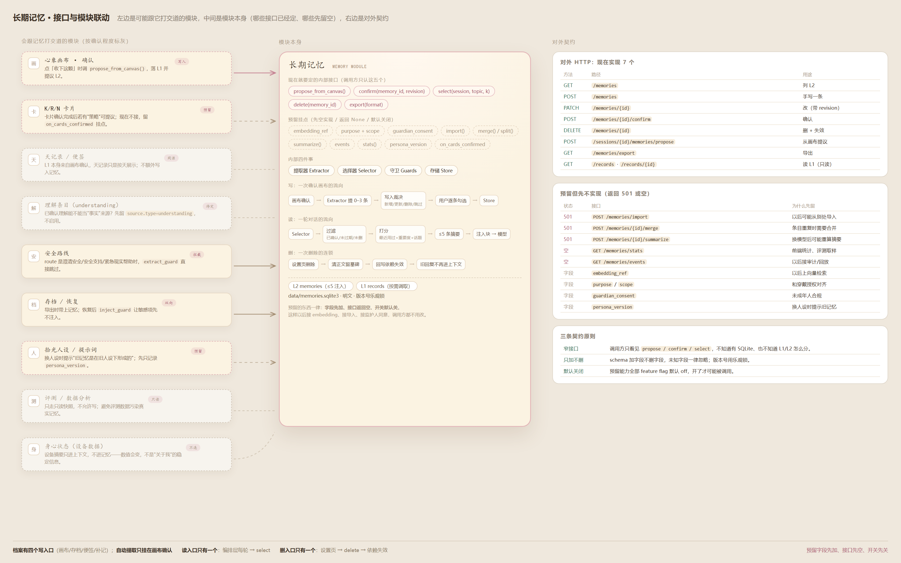
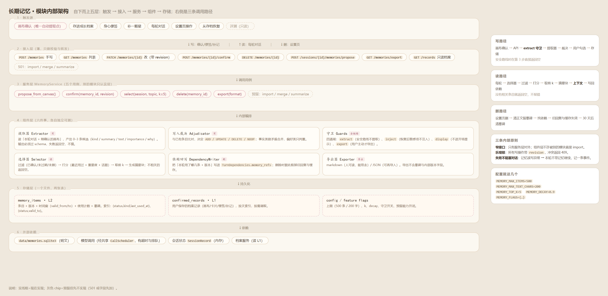

# 长期记忆设计（v0.5）

状态：草案，未实现、未评审
白话在前，技术细节在附录；三张示意图见附录 H（`assets/diagrams/`）。仓库副本见 `docs/long-term-memory.md`。

**v0.5 相对上一版**：① 纠正"画布是唯一写入口"——档案有四个写入口，记忆的自动提取只挂在画布确认；② 补上档案与记忆的六条关系（§1.1）；③ 敏感三层给出权威依据并落到代码（§3）；④ "进行中的事/策略"按 CoALA + Zep + Letta 重新定义（§4.1）；⑤ 补两张联动图与一张内部架构图（附录 H）。

---

**一句话**：让拾光记住"关于你的几件稳定的事"，下次不用从头问；但**每一条都要你点头**，随时能看、能改、能删。

**为什么要做它**——现在有三件事做不到：

1. 换个会话，拾光又问"最近怎么样"，而你上次刚说过在准备期末考；
2. 你说过"别问我家里的事"，下一轮它又绕着问"你爸妈知道你在准备考试吗"；
3. 每次都要重新解释一遍"我不太会表达，别催我"。

**它记什么**

| 记 | 例子 |
|---|---|
| 稳定的事实 | 在准备专业课期末考、和室友小林住一间、妈妈每周会打电话来 |
| 偏好和边界 | 别问家里的事；她说"没事"的时候先别追问 |
| 有时效的事 | 这周在期末周、下周三回家（到期自动不用） |
| 有效的方式 | 先问感受再给建议；拿手环数据说事会让她不舒服 |

**不记**：AI 猜的性格或病、手环数值、一次性的情绪、没确认过的猜测。

**它怎么工作（用户体验三段）**

1. 你在心象画布上点"收下这颗"，它会问一句"要不要记住这几条？"——你也可以自己写；
2. 每次聊天前，最多带 **5 条一句话的备忘**，不是把聊天记录全翻出来；
3. 设置页里能看到一整叠便签，**能看、能改、能删、能导出**。

**它的底线**

- 不点头就不记，AI 只能提议；
- 不用来给你下判断，只影响"怎么说话"；
- 说删就真删，依赖它的旧回复也不会再出现；
- 设置里一个总开关，关了它就不出现。

**现在到哪了**：只有设计稿，还没写代码。

---

## 0. 这一版最大的变化：记忆分成两层

之前把"画布确认的内容"和"AI 顺手记的偏好"混在一起，导致一个问题：**画布是用户签过字的，凭什么过期？**

所以拆开：

| 层 | 叫什么 | 内容 | 期限 | 谁写 |
|---|---|---|---|---|
| **L1 记录库** | 成长档案（用户可见） | 用户主动保存的画布确认、K/R/N、某天便签、"补一颗星" | **永不过期** | 用户保存 |
| **L2 轻记忆** | 便签 | 偏好、边界、进行中的事、有效策略 | **有期限**，到期不再注入 | AI 提议 → 用户点头 |

一句话：**L1 是"我确认过的事实"，L2 是"它顺手记住的偏好"。**

- L1 = 一个可以随时调取的数据库，和成长档案同源；存进档案后长期可用。
- L2 = 便签，会旧、会过期、会被替换。

---

## 1. 用户视角：这两层怎么被用到

**L1 被用到**：每次对话，按当前话题从档案库里取相关的几条（不超过 3 条），比如"上次你说过室友那句话"。
**L2 被用到**：每轮都带（不超过 3 条摘要），决定称呼、语气、不追问的边界。

两层合计**最多 5 条**；没有相关的就是 0 条。

### 1.1 档案（L1）和记忆（L2）到底是什么关系

先纠正一个说法：**"画布是唯一写入口"是错的**。用户主动保存到成长档案的地方至少有四处：

| 写档案的时刻 | 存进去的是 |
|---|---|
| 对话里点「收下这颗」 | 画布五栏 + 留白 + 当天的 K/R/N |
| 点「存进成长档案」 | 这一页的完整记录（含来源与版本） |
| 身心状态里写某天的便签 | 那天的读数 + 用户自己写的话 |
| 在档案地图里点某天「后来呢？」 | 追加一句补充 |

**这四处都进 L1（成长档案），都算"我保存过的记录"，都能被随时调取。但它们不自动变成 L2 便签。**

两者关系就六条：

| | L1 档案 | L2 记忆 |
|---|---|---|
| 回答什么 | **发生过什么**（回顾） | **该怎么跟你说话**（当下） |
| 谁写 | 用户主动保存 | AI 提议 → 用户点头 |
| 寿命 | 永不过期 | 有期限 |
| 注入 | 不进常驻上下文，**按需调取** ≤2 条 | 每轮自动注入 ≤3 条摘要 |
| 变化 | 可以不断补写、编辑 | 可以被替换、过期 |
| 关系 | **L2 的来源之一**，但转过去要**再确认一次** | 不是档案的摘要，是提纯 |

两个具体的联动规则：

1. **从档案提议记忆**：用户在档案里写了"这周在期末考"，系统可以问一句"要不要记住这周在期末？"——**不能自动转**。同理，"补一颗星"里如果出现新的偏好，也只提议。
2. **删除联动**：删掉一条档案时，如果它被用来生成过某条记忆，要提示"这条记忆是从这里来的，要一起删吗？"，**默认不删**，由用户决定。

所以准确的说法是：**档案有四个写入口，记忆的自动提取只挂在其中最有信息量的一个（画布确认）上；其余写档案的时刻只做"可选提议"。**

---

## 2. 普通聊天 vs 心理模式（回答"用户用的是哪种"）

| | 普通聊天 | 心理模式 |
|---|---|---|
| 开关 | `PSYCHOLOGY_ENABLED=false`（默认） | `PSYCHOLOGY_ENABLED=true` |
| 代码路径 | `app/agent/context.py` 的 `build_context` | `app/agent/support_context.py` 的 `prepare_support` |
| 做什么 | 系统提示 + 历史 + 已确认草稿 + 本轮输入 → 自由文本回复 | 额外组装**已授权设备摘要 + 当前确认理解**，调结构化适配器，出 route/reply/画布摘录 |
| 用途 | 兼容旧行为、开发调试 | **产品形态**（画布、确认、来源、安全路线都在这里） |
| 现在线上 | 默认 | 演示时手动开 |

**结论**：**用户实际用的是心理模式**；普通聊天是保底和开发用的。

对记忆的影响：两条路径都要插记忆，所以抽一个公共函数 `memory_block(session_id, topic)` 两边都调。

### 2.1 什么情况会掉到普通聊天（现状 + 我们的决定）

翻了一遍代码，**现在没有"静默降级"这条路**：

| 情况 | 现在会怎样 | 我们希望 |
|---|---|---|
| 服务端关掉 `PSYCHOLOGY_ENABLED`，再新建会话 | 新会话就是普通聊天 | **生产不允许关**，启动时硬校验 |
| 已有心理会话时关掉开关 | 直接 409 `session_mode_conflict`，不降级 | 保持 |
| 适配器失败 / 超时 / 输出不合法 | 抛错 + 独立 `support_notice`，**不退回普通聊天** | 保持 |
| 恢复旧 v1 存档（无业务信息） | 下一条消息升级为心理模式 | 保持（只升级，不降级） |

**决定**：
1. 心理模式是唯一产品路径，`false` 只允许出现在开发/测试；
2. 加启动校验：非 demo/dev 环境且开关为 false 时**拒绝启动**，避免"以为在跑心理模式，其实在跑普通聊天"；
3. 失败就是失败——给失败提示 + 现实支持入口，**不假装成普通聊天**。

### 2.2 那普通聊天要不要废弃

**结论：产品上废弃，代码上保留。**

| | 处理 |
|---|---|
| 用户能看到的入口 | **只留心理模式**，前端不再出现"普通聊天"这个选项 |
| 后端代码路径 | **保留**，改名为"工程模式 / debug"，仅 CLI、离线评测、故障演练使用 |
| 生产配置 | 启动校验禁止 `PSYCHOLOGY_ENABLED=false` |
| 文档 | 标注"deprecated as product path" |

不删代码的三个理由：
1. 现有 636 项测试里，消息、草稿、上下文、存档、评测都跑在普通路径上；删了等于重写测试基线；
2. 心理模式更贵更慢（结构化 JSON + 更长提示词），供应商抖动时需要一个"零结构化风险"的对照路径做诊断；
3. 离线评测要求"真实模型调用 0 次"，只有普通路径的模拟模型能满足。

**所以"废弃"指的是产品定位，不是删文件。**

### 2.3 心理模式后续还会补什么（用户能看到的变化）

| 阶段 | 要加的 |
|---|---|
| 近期（和我们这轮设计绑定） | 画布对象、K/R/N 卡片、某天便签、长期记忆、提示语生成 |
| 中期 | 拾光人设/性格选择、流式输出、按天的成长地图 |
| 上线前必须补 | 年龄识别、监护人同意、多用户身份与归属、加密、速率与成本控制 |
| 明确不做 | 自动训练、跨用户记忆共享、自动外部行动 |

---

## 3. 敏感类是干什么的

### 3.1 权威依据（不是我们自己想的）

- **《个人信息保护法》第 28 条**：敏感个人信息 = 一旦泄露或非法使用，容易导致人格尊严受侵害或人身、财产安全受危害的信息，包括**生物识别、宗教信仰、特定身份、医疗健康、金融账户、行踪轨迹**，以及**不满十四周岁未成年人的个人信息**。
- **第 29 条**：处理敏感个人信息要**单独同意**。
- **第 31 条**：处理不满十四周岁未成年人个人信息，要取得**父母或其他监护人同意**，并制定**专门的处理规则**。
- **《儿童个人信息网络保护规定》第 9、10、14 条**：要显著告知监护人并征得同意；告知**目的、方式、范围、存储地点与期限、到期处理、更正与删除途径**；超出约定范围要再次征得同意。
- **WHO《帮助青少年茁壮成长（HAT）》**：青少年心理干预要把**自伤与自杀预防**单列，不能与普通支持混在一起。

### 3.2 我们的三层清单（行为规则）

**第一层 · 法律定义（默认全部按敏感处理）**
生物识别、宗教信仰、特定身份、医疗健康（含诊断、用药）、金融账户、行踪轨迹；**以及未满 14 岁用户的任何个人信息**。

**第二层 · 场景风险（心理产品特有，待杨烁寒确认）**
自伤/自杀（意念、计划、方法）、虐待与暴力（施害者、细节）、性相关内容、涉法事件、家庭冲突中可识别的人与地点。

**第三层 · 行为规则（这些是代码要做的）**
1. 安全路线（澄清安全 / 安全支持 / 紧急现实帮助）那几轮，**一条都不提取**；
2. 敏感类只允许**用户自己手写**，AI 不自动提议；
3. 从存档恢复后，敏感类**不自动注入**，先问一句"还记得这些吗"；
4. 不进入开场提示，不做"我记得你…"式的主动提及；
5. 导出必须由用户主动触发。

### 3.3 一个必须承认的现实

项目现在**没有年龄识别、没有监护人同意、没有多用户身份**。按第 31 条，真实未成年人数据是**不能上线**的。

所以在补齐这些之前：只允许虚构数据 + 本机演示（和现在 README 的口径一致）。记忆模块把"年龄/监护人同意"预留成 `consent_scope` 字段，但不假装已经实现。

### 3.4 三层怎么落进记忆模块

| 层 | 在代码里表现成什么 | 落点 | 失败时怎么办 |
|---|---|---|---|
| 法律定义层 | `sensitivity = legal` + `never_store` 类别表 | 提取器前置过滤器；写入接口校验 | 直接拒绝写入，返回 422 |
| 场景风险层 | `risk_tags[]`（self_harm / abuse / sexual / legal / family） | 提取器标记；设置页提示"这类只允许你自己写" | 降级为"仅手动"，不删除 |
| 行为规则层 | 四个 guard 函数 | ①`extract_guard`（route 检查）②`inject_guard`（恢复会话）③`display_guard`（开场提示）④`export_guard`（导出） | 任一 guard 不通过 → 跳过，不报错 |

一句话：**法律层是"不许写"，风险层是"只能你写"，行为层是"什么时候不出现"。**

---

## 4. 过期只管 L2

| 类型 | 过期规则 |
|---|---|
| L1 画布确认内容 | **永不过期** |
| L2 进行中的事 | 默认 30 天，必带期限 |
| L2 有效策略 | 90 天后转"待复查"，问一句还准不准 |
| L2 事实 / 偏好 | 不过期；180 天没用标"陈旧"（只提示） |

过期判定：**惰性过滤**（读的时候看 `valid_to` 是否已过），不跑定时任务。不过期 ≠ 删除：`valid_to` 到期只是不再注入，条目仍可查。

### 4.1 进行中的事 / 策略：业界是怎么设计的

查了三类主流系统，结论很一致：

| 系统 | 做法 | 对我们有用的点 |
|---|---|---|
| **CoALA**（语言智能体认知架构综述） | 长期记忆分 **episodic（经历）/ semantic（事实）/ procedural（技能）** | 我们的"进行中的事"是 episodic，"事实/偏好"是 semantic，"策略"是 procedural——**分类有学术依据，不是拍脑袋** |
| **Zep / Graphiti**（时序知识图谱） | 每条事实带 `valid_from / valid_to`；事实过期是**标记失效，不是删除**，支持"当时是什么"的查询 | 把 `expires_at` 换成 `valid_from / valid_to`，语义更准：**失效 ≠ 删除** |
| **Letta / MemGPT** | 四层：message buffer、**core memory（常驻上下文、有字符上限、可编辑）**、recall（可搜历史）、archival（外部存储、按需调取） | 我们的"每轮 ≤5 条摘要"就是 core memory；L1 确认库就是 archival——**按需调取，不常驻** |
| **Mem0** | 写入时用 ADD/UPDATE/DELETE/NOOP 做矛盾合并 | 我们已经吸收（见 §5） |
| **Claude Code** | 自动记忆里的 `project` 类型专存"正在进行的工作、截止日期" | 印证"进行中的事"必须单独一类 |

**迁移到我们的四个决定**：

1. **字段改成时间窗**：`valid_from` + `valid_to`（`valid_to = null` 表示仍有效）。到期不是删，是把 `valid_to` 设成过去时间，历史仍可查。
2. **三类记忆的定位**：
   - 事实/偏好 = semantic（不过期，长期）
   - 进行中的事 = episodic + 时间窗（必须 `valid_to`）
   - 策略 = procedural（`review_at` + `evidence_count`）
3. **策略怎么"复查"**：每被用户确认有效一次 `evidence_count += 1`；`review_at` 到期时问一句"这条还有效吗"，答有 → 续期，答无 → `valid_to` 置为现在。
4. **L1 用 archival 思路**：不常驻，只在话题相关时按需调取 ≤2 条，避免每轮都带"上一次的经历"。

一句话：**"进行中的事"要有时间窗，"策略"要有复查，"事实"可以长期躺着——这三种寿命本来就不一样。**

---

## 5. 打分：不拍数字，用三个信号

参考 Stanford **Generative Agents**（Park et al., 2023）的记忆检索公式，业界（MemoRizz 等）默认照搬：

```
score = α_r · recency + α_i · importance + α_a · relevance
三项都先归一化到 [0,1]，α 默认都是 1
recency  = decay ^ 距上次被使用的天数      （decay 默认 0.995 / 小时，我们按天取 0.9）
importance = 写入时打的 1–5 分（会不会改变下一句话）
relevance = 与当前话题的相似度（第一版用关键词/类别匹配，不做向量）
```

**关键点（和原方案不同）**：
- 不再用"总分 ≥3"这种拍脑袋阈值；
- 改成 **top-k + 相关性门槛**：先按 `relevance` 过滤掉不相关的（低于门槛直接不进候选），再按三项加权排序取前 k；
- `recency` 锚定**上次被使用的时刻**，不是创建时间——**常用的记忆衰减慢**，这正好实现你说的"常提到的打高分"。

写入时还有一步**裁决**，参考 Mem0 的做法：新候选先和已有条目比对，输出四种操作之一：

| 操作 | 什么时候 |
|---|---|
| ADD | 新的、不冲突 |
| UPDATE | 同一件事但更完整/更新 |
| DELETE | 新信息推翻了旧的（如"搬宿舍了"推翻"住 3 号楼"） |
| NOOP | 已经有了，跳过 |

> 备注：Mem0 v3 取消了写入时的矛盾合并，改成只 ADD、靠检索排序解决。我们的场景里"记忆说错了会很伤人"，所以**保留写入裁决**，但只为"事实类"做，偏好类只做 NOOP 判断。

---

## 6. 写档案的四个时刻，和自动提取的那一个

档案（L1）有四个写入口（见 §1.1）：画布确认、存进成长档案、身心便签、"补一颗星"。

**自动提取记忆只挂在"画布确认"上**，因为那一刻信息最全、用户注意力在。其余三个时刻只做**可选提议**：

| 时刻 | 档案动作 | 记忆动作 |
|---|---|---|
| 点「收下这颗」 | 写一条记录 | **自动提议 0–3 条**（唯一自动点） |
| 点「存进成长档案」 | 写整页记录 | 不提议 |
| 身心状态写某天便签 | 写那天的记录 | 可提议 1 条（"要记住这周在期末吗？"），默认不弹 |
| 地图里「补一颗星」 | 追加到那天 | 可提议 1 条，默认不弹 |

### 6.1 画布确认那一刻，按顺序发生

1. **落 L1**：五栏 + 留白 + K/R/N 存成一条"经历记录"（版本 + 来源），同步进成长档案；
2. **提议 L2**：拿这一轮对话 + 刚确认的画布，让模型提 0–3 条候选（偏好 / 进行中的事 / 策略）：
   - 每条带 `summary`（≤30 字，策略类放宽到 50 字）、`text`、`kind`、`importance`、`why`（一句话给用户看）；
   - 先做写入裁决（ADD/UPDATE/DELETE/NOOP），冲突的直接标出来；
3. **展示**：在画布下方一行"要不要记住这几条？"逐条勾选；
4. **确认后入库**，未勾选的丢弃。

**如果这一轮是安全路线，第 2 步整体跳过。**

---

## 7. 从 Claude Code / DSH 学到的（保留精简版）

参考：[Claude Code 记忆文档](https://code.claude.com/docs/en/memory)

- 索引 + 详情两段式 → 我们注入只喂摘要，全文在设置页；
- 分四类（user/feedback/project/reference）→ 映射成事实/偏好/进行中的事/策略；
- 会过期的"进行中的事" → L2 必带期限；
- 不每次会话都存 → 只在确认画布时提取；
- 跳过能推导的 → 本轮说过的、画布确认过的不重复记；
- 纯文本可导出 → 支持导出；
- 记忆 ≠ 上下文压缩 → 压缩绝不写记忆；
- DSH：恢复会话要重新武装 → 恢复后敏感 L2 不自动注入。

**有意偏离**：Claude Code 自动记忆默认开，我们默认关。

---

## 8. 存储与配置

- 新文件 `data/memories.sqlite3`（不塞进聊天存档库：存档是整段快照、一次写一大坨；记忆是一条条改、要跨会话、要导出）。
- 上限（暂定，全部走配置，不写死）：`MEMORY_MAX_ITEMS=500`、`MEMORY_MAX_TEXT_CHARS=200`、`MEMORY_SUMMARY_CHARS=30`、`MEMORY_STRATEGY_SUMMARY_CHARS=50`、`MEMORY_TOP_K=5`、`MEMORY_DECAY=0.9`。
- 删除：墓碑（清正文留 id/时间/状态），30 天后物理删。
- **内容列加密**（与画布同方案，见《接口预留清单》）：AES-256-GCM，`text/summary` 密文、索引列明文；密钥 `data/.memory.key` 或 `MEMORY_ENC_KEY`；密文旁记 `enc_key_id`。
- **现状**：已实现的 v0.1 仍是明文；加密作为下一步迁移（迁移器骨架 + 历史行重加密），迁移前文档里不宣称已加密。

---

## 9. M1 做什么

1. L1 确认库：画布确认 → 存一条经历记录（含版本、来源）→ 可按话题调取；
2. L2 最小闭环：手动加一条 + 确认画布时提议 + 每轮注入 ≤3 条 + 删除失效；
5. 加密迁移的时间点（已定：内容列要加密，见 §12）
4. 设置页：一叠便签，能看能改能删能导出。

**暂不做**：向量检索、策略类、关系类、导入、自动提取（M2）。

---

## 10. 还没定

1. 关键词匹配的具体做法（分词？类别标签？）
2. `relevance` 门槛设多少（先跑数据再看）
3. `importance` 由模型打还是规则打
4. 显式提示的频率
5. 是否要加密
6. 敏感清单（杨烁寒）、保留期（盛蕾）、提示位置（蔡政洋）

---

## 11. 以后加账号系统怎么办

结论：**现在不用做账号，但有三处要提前埋好**，否则以后是改表 + 改接口 + 改测试的大手术。

### 11.1 现在（单用户本机）

- 没有用户身份，`session_id` 只是会话编号，**不是身份**（现有文档已写死这条）；
- 所有记忆条数上限都是"单用户"假设，实际是"整库"。

### 11.2 加账号后必须变的

| 位置 | 现在 | 加账号后 |
|---|---|---|
| 数据表 | 无 owner | 两张表都加 `owner_id`，**所有索引以 owner 打头** |
| 接口 | 路由只认 session/record id | 路由从登录态取 `current_user`，**不信任客户端传的 owner** |
| 查询 | DAO 里全表查 | DAO **强制**加 `owner_id = ?`（写在存储层，不写在路由里） |
| 越权 | 不存在 | 别人的 memory_id 一律返回 **404**（不返回 403，避免探测存在性） |
| 配额 | 全库 500 条 | 改成**每用户** 500 条 |
| 注销 | 无 | 按 owner 级联删除记忆 + 档案 + 存档 |
| 导出 | 全库导出 | 只导出当前用户（PIPL 的可携带权） |
| 会话内存 | 单进程内存 | 需要换成可跨进程的会话存储（否则多实例会串号） |
| 调度器 | 全局并发上限 | 需要按用户分配配额，防一个用户打满 |

### 11.3 现在就要埋的三处（成本极低）

1. **`owner_id` 字段先加上**，默认值 `local`（本机演示用户）。以后只需要把默认值换成真实用户 id，不用 ALTER TABLE 再迁数据。
2. **服务层签名带 owner**：`select(owner_id, session_id, topic, k)`、`delete(owner_id, memory_id)`。即使现在传 `"local"`，以后也不用改调用方。
3. **存储层统一注入过滤**：所有 SQL 由 DAO 拼 `owner_id`，路由和业务代码没有机会漏写。测试加一条"跨用户访问返回 404"。

### 11.4 顺带要重新想的两件事

- **未成年人合规**：有了账号就能做年龄分层；不满 14 岁的按第 31 条需要监护人同意，这条会直接改变记忆的写入流程（`guardian_consent` 字段已经预留）。
- **多设备**：记忆是"这个人"的，不是"这台设备"的；账号化以后要把本机记忆归并到账号下，并处理冲突（同一事实两个设备各记一条）。

---

## 12. 预留（与《接口预留清单》对齐）

已实现部分是 v0.1；下面这些是**加在表上/接口上、但不改变现有行为**的预留位，和画布模块共用同一套规矩。

### 12.1 字段

| 字段 | 现在取值 | 将来用在哪 |
|---|---|---|
| `owner_id` | `local` | 账号系统（**已实现**） |
| `schema_version` | `memory.v1` | 结构演进（新增） |
| `enc_key_id` | `k1` | 密钥轮换（随加密迁移加） |
| `purpose` | `support` | 用途限定、导出过滤（新增，可空） |
| `guardian_consent` | `null` | 未成年人同意（新增，可空） |
| `embedding_ref` | `null` | 向量检索（二期，先占位） |
| `persona_version` | `null` | 记忆由哪版人格/提示词提炼 |

### 12.2 接口

- `GET /memories?limit=&cursor=`：本期忽略 `cursor`，默认返回全量；
- `POST /memories/propose` 已返回 501，等画布确认接入；
- `/health.modules.memory` 暴露 `enabled` 与 `schema_version`；
- 事件：`memory.proposed`、`memory.confirmed`、`memory.deleted`（走 `app/events.py`，M1 同步内存版）。

### 12.3 迁移

- 三个库统一补**迁移器**：`PRAGMA user_version` + `MIGRATIONS` 阶梯，不再只靠 `CREATE TABLE IF NOT EXISTS`；
- 加密迁移顺序：补 `enc_key_id` → 读旧明文行时自动加密回写 → 迁移完成后新写入一律密文。

---

## 附录 A：数据结构

```jsonc
// L2 轻记忆
{
  "memory_id": "mem_7f3a2c",
  "kind": "context",               // preference | context（进行中的事）| strategy | fact
  "memory_class": "episodic",      // semantic | episodic | procedural（CoALA 分类，便于后续扩展）
  "summary": "这周在期末考",         // ≤30 字（策略 ≤50）
  "text": "本周是期末周，到下周五结束。",
  "importance": 4,                 // 1–5，写入时打
  "source": {"type": "user_stated", "session_id": "…", "message_index": 12},
  "derived_from_record_id": null, // 如果是从某条档案提议来的，记下 record_id（删除时用）
  "status": "confirmed",           // proposed | confirmed | expired | superseded | deleted
  "version": 2,
  "valid_from": "2026-11-16T00:00:00+08:00",
  "valid_to": "2026-11-27T00:00:00+08:00",   // null = 长期有效
  "review_at": null,               // 策略类专用：到期复查
  "evidence_count": 0,             // 策略类专用：被确认有效几次
  "last_used_at": "…", "use_count": 7,
  "risk_tags": [],                 // 场景风险标记，见 §3.4
  "created_at": "…", "updated_at": "…", "deleted_at": null
}

// L1 确认库（从画布来）
{
  "record_id": "rec_91b2",
  "session_id": "…",
  "canvas_revision": 3,
  "confirmed_at": "…",
  "lanes": {"facts": [...], "interpretations": [...], "feelings": [...], "needs": [...], "unknowns": [...]},
  "cards": [{"kind": "keep", "text": "…"}, {"kind": "release", "text": "…"}],
  "device_summary": {...},         // 只存摘要，不存原始日记录
  "day": "2026-11-13",
  "status": "active"               // active | archived | deleted
}
```

## 附录 B：表

```sql
CREATE TABLE memory_items (        -- L2
  memory_id TEXT PRIMARY KEY,
  owner_id TEXT NOT NULL DEFAULT 'local',   -- 账号系统上线后换成真实用户 id
  kind TEXT NOT NULL, memory_class TEXT NOT NULL,
  summary TEXT NOT NULL, text TEXT NOT NULL,
  importance INTEGER NOT NULL, source_json TEXT NOT NULL, status TEXT NOT NULL,
  derived_from_record_id TEXT,
  version INTEGER NOT NULL, use_count INTEGER NOT NULL DEFAULT 0, last_used_at TEXT,
  valid_from TEXT NOT NULL, valid_to TEXT,
  review_at TEXT, evidence_count INTEGER NOT NULL DEFAULT 0,
  risk_tags_json TEXT NOT NULL DEFAULT '[]',
  created_at TEXT NOT NULL, updated_at TEXT NOT NULL, deleted_at TEXT
);
CREATE INDEX idx_item_pick ON memory_items(owner_id, status, kind, last_used_at DESC);
CREATE INDEX idx_item_valid ON memory_items(owner_id, status, valid_to);

CREATE TABLE confirmed_records (   -- L1
  record_id TEXT PRIMARY KEY, owner_id TEXT NOT NULL DEFAULT 'local', session_id TEXT NOT NULL, canvas_revision INTEGER NOT NULL,
  payload_json TEXT NOT NULL, day TEXT, status TEXT NOT NULL,
  created_at TEXT NOT NULL, updated_at TEXT NOT NULL, deleted_at TEXT
);
CREATE INDEX idx_rec_day ON confirmed_records(owner_id, status, day DESC);
```

## 附录 C：接口

| 方法 | 路径 | 作用 |
|---|---|---|
| GET | `/memories` | 列 L2（可筛；支持 `limit/cursor`，本期忽略 cursor） |
| POST | `/memories` | 手写一条 |
| PATCH | `/memories/{id}` | 改（带版本） |
| POST | `/memories/{id}/confirm` | 确认 |
| DELETE | `/memories/{id}` | 删 + 失效 |
| POST | `/sessions/{id}/memories/propose` | 从画布生成候选（不落库） |
| POST | `/records/{id}/memories/propose` | **从某条档案提议**（便签/补记），需用户再确认 |
| GET | `/memories/export` | 导出 markdown/JSON |
| GET | `/sessions/{id}/records` | 列 L1 |
| GET | `/records/{id}` | 读一条 L1 |
| DELETE | `/records/{id}?with_memories=false` | 删 L1；返回 `linked_memories[]`，默认**不**一起删 |

## 附录 D：取数伪代码

```python
def select(session, topic, k=5):
    cands = load(status="confirmed", not_expired=True)          # L2
    recs  = load_records(status="active", day_recent=True)      # L1
    for m in cands: m.relevance = keyword_match(m, topic)       # 0..1
    for r in recs:  r.relevance = keyword_match(r.text(), topic)
    cands = [m for m in cands if m.relevance >= RELEVANCE_FLOOR]
    recs  = [r for r in recs  if r.relevance >= RELEVANCE_FLOOR]
    def score(x):
        return decay ** days_since(x.last_used_at) + norm(x.importance / 5) + x.relevance
    pick = sorted(cands + recs, key=score, reverse=True)[:k]
    return pick, [x.id for x in (cands+recs) if x not in pick]
```

## 附录 E：要改的文件

`app/schemas/memory.py`、`app/services/memory_store.py`、`app/services/memory_service.py`、`app/services/record_service.py`、`app/agent/context.py`、`app/agent/support_context.py`、`app/agent/orchestrator.py`、`app/main.py`、`tests/test_memory_*.py`。

## 附录 F：必测

未确认不注入 / 过期不注入 / L1 永不过期 / 注入的是摘要 / 删了旧回复消失 / 缓存剪枝 / 超预算截断 / 总开关 / 读取失败不阻塞 / 恢复后敏感项不自动注入 / 导出可读回 / 跨会话可读 / 安全路线不提取 / 636 项回归与 14 条评测通过。

## 附录 G：参考

- Generative Agents 检索公式：Park et al. 2023（recency decay 0.995、importance 1–10、relevance cosine，三项归一化后等权相加）— [实现说明](https://github.com/DanceNitra/agora/blob/main/onboarding/game-dev/references/memory-stream-impl.md)
- Mem0 写入裁决 ADD/UPDATE/DELETE/NOOP：[迁移说明](https://docs.mem0.ai/migration/platform-v2-to-v3)
- "按类型设置不同衰减"的讨论：[typed decay preprint](https://zenodo.org/records/22643061)
- CoALA 记忆三分法（semantic / episodic / procedural）：[框架综述](https://browse-export.arxiv.org/pdf/2510.22052)
- Zep / Graphiti 时序有效性（`valid_from` / `valid_to`，失效不删除）：[Graphiti](https://www.getzep.com/platform/graphiti/)
- Letta / MemGPT 记忆分层（core / recall / archival，core 有字符上限且常驻）：[记忆架构](https://github.com/Zurybr/lefarma-skills/blob/main/letta/letta-api-client/memory-architecture.md)
- Claude Code 记忆机制：[官方文档](https://code.claude.com/docs/en/memory)
- 法律依据：[《个人信息保护法》第 28/29/31 条](http://society.people.com.cn/n1/2021/0823/c1008-32204236.html)、[《儿童个人信息网络保护规定》](https://www.gov.cn/zhengce/2019-10/08/content_5728947.htm)
- WHO 青少年心理干预指南（自伤/自杀预防单列）：[HAT 指南](https://www.who.int/docs/default-source/mental-health/guidelines-on-mental-health-promotive-and-preventive-interventions-for-adolescents-hat.pdf)

---

## 附录 H：三张示意图

图都放在 `docs/assets/diagrams/` 下，PNG 可直接看，HTML 可浏览器打开、也能改。

### H.1 与项目全景的联动



- 图：`assets/diagrams/memory-map.png`
- 源文件：`assets/diagrams/memory-map.html`
- 说明：六个模块关系 + 一条"明确不连"（设备数据不进记忆）。

### H.2 接口与模块联动



- 图：`assets/diagrams/memory-interfaces.png`
- 源文件：`assets/diagrams/memory-interfaces.html`
- 说明：左边是九个可能打交道的模块，中间是已定接口 + 预留挂点，右边是对外契约；底部是写/读/删三条流向。

### H.3 模块内部架构



- 图：`assets/diagrams/memory-arch.png`
- 源文件：`assets/diagrams/memory-arch.html`
- 说明：自下而上五层（触发 → 接入 → 服务 → 组件 → 存储），右侧是写/读/删三条调用路径。
