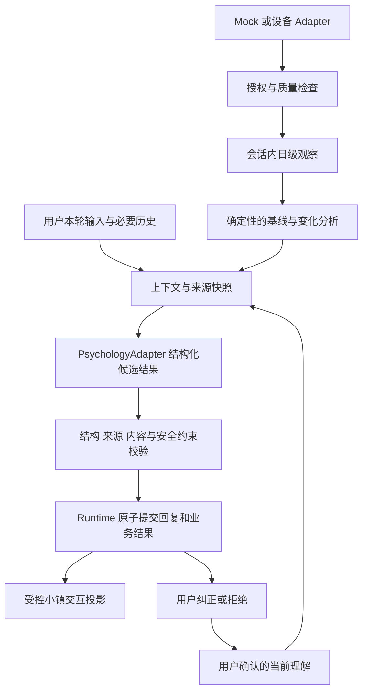

# 盛蕾 Applied AI & Safety：开发方案

状态：模块 1—6 的独立工程模块已实现；模块 7—10 待开发，心理策略尚待专业审核，字段仍待团队接缝确认。阈值和工期为建议。
编写日期：2026-11-04（Asia/Shanghai）。
代码基线：[kokoJesee/lingyv](https://github.com/kokoJesee/lingyv)，提交 `ae97cac32b0a4d44a7083045d1fa3d4782efccfe`。
需求来源：[Personal Emotional Agent](https://app.notion.com/p/405b09136ad58003ba52c7701a1e69c1)，本次读取版本最后编辑于 2026-10-26。
产品调研：[官方产品与技术资料调研](shenglei-product-research.md)。
模拟数据扩展：[30 项可穿戴指标与十组场景规格 v0.2](shenglei-wearable-metrics.md)。
本次修订：由两项基础指标扩展为 30 项模拟指标；仍以模拟器为首版输入，真实设备能力逐项核实。

## 1. 本次范围与决定

初次交付为调研与开发方案；现已完成模块 1 的契约、样例及模块 2 的内存数据服务和授权控制，其余业务功能未实现。方案遵循 AGENTS.md、harness-transfer.md、runtime-contract.md、development.md、psychology-interface.md。

盛蕾负责四项：可穿戴数据处理、个人状态变化分析、安全支持流程、Agent 集成协作。交付目标是现有 Python/FastAPI Agent 上的一条可复现闭环：

**明确选择模拟/真实数据用途 → 日级观察 → 与个人基线比较 → 带证据的澄清 → 用户纠正当前理解 → 后续回复和小镇动作随之改变 → 独立测试验证。**

### 优先级

- P0：模拟输入、日级清洗、可解释趋势、授权控制、对接既有心理接口、四条回应路线的工程执行、错误/取消处理、来源记录、可纠正理解和小型演示接口。
- P1：显式保存恢复的扩展、接口前端展示、独立业务评测；在完整比赛 Demo 前完成其必要部分。
- P2：真实设备 SDK/OAuth、跨会话个人账户、长期趋势、生产部署、更多小镇角色。只有真实设备和授权条件已具备才前移。
- 本轮不承担病例生成平台、模型训练、诊断预测、完整小镇、B 端销售系统。它们分别属于其他分工或未来产品路线。

第一轮仅做本机单用户、虚构成年人物与模拟指标演示。真实数据或网络多人试用需要另外补身份、归属、存储保护、访问控制与数据生命周期；不能仅用 session UUID 充当身份认证。

## 2. 仓库已有什么，缺什么

| 已读证据 | 已实现 | 本任务需要补齐 |
|---|---|---|
| `app/main.py`、`app/agent/orchestrator.py` | FastAPI 消息入口、同会话串行、请求去重、失败整轮回滚、取消/清空屏障 | 业务 pipeline；新增接口必须沿用锁、revision 和取消机制 |
| `app/llm/client.py`、`prompts.py` | DeepSeek 文本回复；静态系统提示；空输出与非 stop 拒绝 | 专用结构化心理适配器；现有客户端固定 system prompt，不能直接当作通用结构化客户端 |
| `app/agent/context.py` | 对话＋当前已确认草稿；旧草稿依赖助手回复剔除；字符预算 | 设备观察、分析、纠正来源；通用依赖失效；心理请求输入映射 |
| `app/services/draft_service.py` | 版本绑定的编辑/确认/拒绝及操作去重 | 可复用机制，但 `title/items` 只是通用示例，不是心理记忆格式 |
| `docs/psychology-interface.md` 和两个 schema | PsychologyRequest/Response 草案；4 个 route；来源类型已约定 | Python 模型、Adapter、来源校验、实际调用均未落地；`memory_update` 仍必须为 null |
| `app/evaluation/*` | 工程模拟评测运行器，检查预算、重复、取消、草稿 | 心理/状态任务的案例格式、审核标签和独立业务评测，不能把工程通过率当效果证据 |
| `app/services/archive_service.py`、`schemas/archive.py` | 默认内存，主动保存 SQLite snapshot v1 | 新增授权、观察、理解及依赖的版本化存档；不能假设现有保存自动覆盖新字段 |
| `app/schemas/session.py`、README | 业务状态 INITIAL；单用户本机；存档明文 | 安全 route 与 Session.state、WorkflowPhase 分离；无前端、小镇或账号体系 |

### 开始前要处理的协作问题

1. `AGENTS.md` 引用的 `docs/team-handoff.md` 在该提交未找到；`development.md` 引用的 `LoveStone_Agent接口契约草案_2026-10-31.md` 也未随仓库提供。不得据引用推断其中字段。现以已提交的 psychology v0.1.0 为基线，请张俊杰补团队共享快照。
2. 仓库没有本机 `local.paths.json`；不依赖作者个人 Obsidian。所有交付进入 `docs/`，数据和报告按现有忽略规则保存。
3. `requirements.txt` 为 UTF-16 编码；安装与跨平台测试实际结果见文末验证记录。
4. 仓库后续若有提交，实施前比较涉及 orchestrator/context/psychology/schema 的 diff，再更新本方案引用。

## 3. 产品调研如何落到选择

详见独立调研文档；下面列决策而非复刻产品内部算法。

| 参考机制 | 本项目采用 | 本轮不据此宣称 |
|---|---|---|
| Oura 用个人基线解释生理变化；生理压力和主观感受不同 | 数值计算确定性实现；只输出相对个人习惯的变化，并询问用户 | 从睡眠或心率计算焦虑症、危机概率 |
| Oura Advisor 将指标与对话结合，允许查看/删除记忆，按用户选择启用 | 数据用途开关、结构化观察、用户可纠正记录、删除失效 | 只要聊天就默认允许所有设备数据发给云模型 |
| HealthKit/Health Connect 是平台原生健康数据接口 | adapter 隔离平台，P0 mock 日级记录；后续原生桥或可用云 API | FastAPI 网页可直接读取用户手机健康数据库 |
| Wysa 公开区分情绪支持和危机服务 | 独立安全路线、资源入口、故障提示和真人支持边界 | 模型完成临床风险评估或已联系救援 |
| 仓库已有完整提交与来源机制 | 接入既有 runtime；扩展依赖版本，结果校验后统一提交 | 再造一套独立 Agent 调度和数据库 |

Oura Advisor 官方来源：[Member Care](https://ouraringhelp.zendesk.com/hc/en-us/articles/39512345699219-Oura-Advisor)。其公开说明可支持可选启用、健康数据结合语言模型、记忆管理等产品行为；未披露的内部实现不作推断。

## 4. 推荐模块边界



这里的授权检查只限制可选设备与记忆资料；用户主动表达的安全需要不以连接设备或确认草稿为前提。mock 与 live 均走同一服务接口，模拟数据在界面、输入和报告中持续标明。

建议新增路径（均未实现）：

```text
app/schemas/wearable.py           # 日级指标、来源、质量、用途授权
app/schemas/state_analysis.py     # 窗口、基线、观察差值、证据引用
app/schemas/understanding.py      # 用户可纠正的理解记录
app/schemas/psychology.py         # 对应已提交 0.1.0 契约
app/schemas/support.py            # 路线、策略版本、交互投影
app/wearables/base.py             # Adapter 协议
app/wearables/mock.py             # 固定时钟、固定虚构 fixtures
app/services/wearable_service.py  # 导入、去重、授权、删除、revision
app/services/state_analysis.py   # 纯计算，不调用 LLM
app/services/understanding_service.py
app/psychology/adapter.py         # 输入转换、模型结果解析、引用验证
app/psychology/policy.py          # 审核后的路线约束与降级
app/psychology/prompts.py         # 独立提示版本
app/services/interaction_service.py # 白名单动作提议/接受
app/state_demo_cli.py             # 无前端也可演示完整闭环
```

已有 `main.py` 负责挂载路由；先保持当前组织，不为本轮大规模重构路由。新增模块通过依赖注入支持 mock。

## 5. 可穿戴处理：输入、质量与授权

### 5.1 MVP 指标与时间

参考 Oura、Apple Watch Vitals 和 Garmin，首版模拟覆盖 **30 项指标**：睡眠 11 项、心率与 HRV 6 项、呼吸/血氧/皮肤温度 3 项、活动 5 项、厂商评分与压力时长 5 项。完整字段、类型和来源见 [指标字典](shenglei-wearable-metrics.md)。

核心分析包含总睡眠、入睡时点、效率、静息心率、夜间 RMSSD、呼吸、皮肤温度偏差、步数和运动时长。SDNN 独立存储；评分仅作为模拟设备估算展示，不跨厂商合并。HRV 纳入模拟，但测量方法、采样窗口、设备与算法版本必须明确。

- 存储测量时段 UTC 时间＋原始 offset；日归属用明确 IANA timezone。
- 睡眠归入醒来的本地日期，区分主睡眠与小睡；第一版只用主睡眠。
- 步数只对已结束的完整本地日进行跨日比较；今天尚未结束不与昨日全天总步数比较。
- 设备切换后重新建立基线或显式分源，不将多个设备的全日步数累加。
- 不足一天、来源无法判断或仅部分同步标记 incomplete/unknown；不把缺失填 0。

### 5.2 建议契约

`WearableDailyRecord`：schema_version、record_id、record_revision、provider、provider_record_id、is_simulated、local_date、timezone、observed_start/end、ingested_at、metrics。
每个 metric 含 value_type、value、unit、measurement_kind、method、aggregation、window、source_algorithm_version、quality（valid/missing/incomplete/invalid/unknown）、quality_reasons、coverage（已知时填写，不能编造）、dependency_refs；注册表严格规定有限数/非负计数/带时区 timestamp 等类型，不允许任意混用。温度偏差有 baseline_ref，厂商分数有 namespace/scale/score_origin。owner/session_id 由服务端绑定，禁止信任导入文件指定的其他会话。

`DataUseConsent`：consent_id、revision、session_id、provider、allowed_metrics、scopes、granted_at、revoked_at。
scopes 至少拆开 `local_analysis`、`model_context`；存档通过显式保存选择控制，不与前两者捆绑。

**本地分析授权与发给云模型授权是两个动作。** 允许本地看趋势但拒绝 model_context 时，Agent 请求里不得出现设备摘要。

拟议内部接口：

```python
class WearableAdapter(Protocol):
    async def fetch_daily(self, query: DailyQuery) -> list[WearableDailyRecord]: ...

normalize_and_validate(raw_records, import_context) -> ImportResult
analyze_changes(records, as_of, config) -> StateAnalysis
```

P0 的 mock 根据十组预置场景、固定 seed/generator_version/as_of 返回 30 日摘要；可附选定日的区间曲线和 sleep/workout 事件。每日、区间与事件使用不同 Schema；能力配置区分基础、进阶与组合测试设备。先生成睡眠/运动事件，再生成相关指标和摘要；保留缺测、不支持与主观感受不一致场景。数值约束与生成顺序见指标规格，不用每次独立随机生成。批次中 schema 错误或记录键冲突整批拒绝；合法结构内的无效指标保留质量原因，但排除计算。返回 accepted/unchanged/invalid_metrics 计数。

### 5.3 导入与修订语义

- 操作 request_id/operation_id 去重，与数据记录去重分开。
- 记录键：provider＋provider_record_id；日级没有提供者 ID 时由 adapter 产生稳定键，不能每次 UUID 导致重复。
- 同键同内容：不新增；同键更正：按 expected revision 更新并使旧分析失效；跨设备冲突按显式来源优先级解决。
- 新导入增加 evidence_revision；实际会话变更同步增加 session.revision。
- 运行中普通导入拒绝 busy；撤回授权/清空属于高优先级生命周期操作，先发取消信号再取得锁完成删除。
- 撤回后取消相关运行、作废分析、阻止依赖旧来源的缓存回复重放，保留操作墓碑。撤回不能撤回已经发送给外部模型的数据，界面说明后续停止使用。

## 6. 个人状态分析：确定性数值＋有界解释

所有以下窗口和阈值是比赛工程默认草案，不是 Oura 算法、临床界值或经验证的心理指标。

### 6.1 第一版算法

- recent：截至 as_of 的最近 3 个完整本地日；每项指标至少 2 个 valid 日。
- baseline：recent 之前连续 14 个日历日；每项至少 10 个 valid 日。不能为了凑 14 条跨越无限长时间。
- 对可比的数值指标用 baseline/recent 中位数；温度偏差仅比较 °C 差，基线为 0 不算相对差。入睡时间按跨午夜的相对睡眠日/循环时间处理；设备/HRV 方法不同不混算。评分仅展示自身刻度，不纳入统一心理分。
- 明确窗口起止、有效天数、来源和算法版本。不输出未经校准的“95% 置信度”。
- 可选研究性波动参考用 MAD，但 MVP 不依赖统计异常分数；先保证数值可复核。
- 首版询问候选：睡眠绝对变化至少 60 分钟；步数相对变化至少 30% 且绝对差至少 1500。最终阈值可配置并经团队审核，不用它触发安全路线。
- 无授权、基线不足、近期不足、质量不足、来源冲突分开返回；既不输出“正常”，也不输出“无风险”。

### 6.2 StateAnalysis 输出

当前可运行契约见 `app/schemas/state_analysis.py`，完整虚构 JSON 见 [analysis.json](../examples/wearable/analysis.json)。该样例只演示输出结构，不是对设备样例批次的计算结果。

- `baseline_window` / `recent_window` 使用含首尾日期的 `{start, end}` 对象。
- `metric_id` 与注册表一致；分钟单位为 `min`。入睡时点比较单独采用 `min_from_sleep_day` 与 `sleep_day_relative_minutes`。
- `record_refs` 使用 `{kind, source_id, revision}`，实际分析必须覆盖全部有效来源；Schema 只能检查引用结构，存在性由后续服务验证。
- 结果包含来源设备、方法和算法版本；不输出心理诊断或确认记忆。

### 6.3 状态变化怎样进入心理接口

保持 `PsychologyRequest.records` v0.1.0 的三字段结构，adapter 把有权限使用的分析转换成 `evidence_type=device_observation` 文本，包含模拟标识、时间、有效日数、差值和限制。数值仍以 StateAnalysis 为唯一计算来源。

source_id 是请求内编号：`record_0001`；在内部 sidecar 映射到 analysis_id、记录版本、授权版本，不能直接把全局记录 UUID 当作本轮所有证据 ID。

每轮按用户需要选择最多 3 组、6 个数值的相关观察，完整数据保留在服务端可查；同源睡眠指标不作为多份独立证据。日内曲线和场景隐藏标签不发给模型。

正常询问以用户主动表达和需要为前提；不会每轮重复播报同一个趋势。session 中记录已呈现 observation 的 ID；用户选择“暂时别问”后，本会话不再主动重复，除非用户重开话题。

## 7. 用户纠正与记忆边界

### 7.1 复用机制，但不混淆字段

现有 DemoDraft 的 title/items 可以用于早期通路演示；正式闭环新增 `UnderstandingRecord`，复用 DraftService 的版本绑定、操作去重、确认令牌思路，不把健康授权塞进草稿，不把模型生成的字段自动写成事实。

建议字段：id、session_id、revision、status（proposed/confirmed/rejected）、statement、evidence_refs、origin（user_report/hypothesis）、scope（session）、supersedes_id、confirmed_revision。确认只表示用户认可“自己的当前解释”，不表示专业客观结论。

- 新理解默认为 proposed；用户修改使旧版本确认失效。
- 用户确认绑定当前记录、版本和凭据；迟到确认 409。
- 当前消息里的自然语言纠正立即作为用户自述参与本轮，即使用户尚未点击“保存理解”；不能以没点按钮为由忽略纠正。
- 只有显式确认后写入 confirmed record。解析自然语言得到的更新建议仍是 proposed。
- 与已有记录冲突时，旧记录暂时停用、等待用户确认修订；不在后台悄悄覆盖。
- `PsychologyResponse.memory_update` v0.1.0 继续为 null。理解记录经独立用户操作接口更新；若未来要模型提出结构化更新，发布 v0.2 并让相关方审核，不能塞进现有严格 Schema。

### 7.2 来源失效必须传递到后续输入

目前 `turn_sources` 只有 DraftReference。新增 `EvidenceReference(kind, id, revision)`，涵盖 draft/analysis/understanding/consent 依赖。旧理解被拒绝或修订时：

1. 停用当前理解记录；
2. 后续 context 排除依赖已失效记录的助手回复；
3. 用户原话保留其历史身份，不被改写；当前纠正优先；
4. 已完成旧请求重放仅在依赖仍允许时返回历史结果；撤回数据用途后缓存失效返回已撤回错误，绝不重新执行同 request_id；
5. 存档恢复也携带依赖并重新检查授权，不恢复旧执行凭据。

第一版个人化范围是同一会话及其显式恢复。跨新会话自动认出同一用户属于账户/长期记忆工作，不在该能力上作假演示。

## 8. 安全支持：对齐已有四条路线

直接采用 psychology v0.1.0 的 route：routine_support、clarify_safety、safety_support、urgent_real_world_help；不另造低中高风险分数。路线表示回应方式，不等于诊断或临床风险等级。

| 路线 | 程序行为（建议，回应由杨烁寒审核） | 交互要求 |
|---|---|---|
| routine_support | 按当下意愿倾听、澄清或提出小行动 | 普通小镇互动可用，接受动作仍由用户决定 |
| clarify_safety | 优先提出必要的安全澄清；下一轮按新材料重新判断 | 降低装饰性打扰，不先要求确认草稿 |
| safety_support | 展示经审核的现实支持内容及可用入口 | 停止普通任务引导；不宣称已联系他人 |
| urgent_real_world_help | 优先展示经审核的及时现实帮助内容 | 不等待设备同步、游戏步骤或普通表单 |

### 8.1 执行机制

一个 `psychology.evaluate` 调用同时产生 route、reply、evidence_refs 等候选结果；程序完成严格结构、来源、会话版本、策略约束检查。规则只作为审核后的约束/辅助检测，不把关键词命中或一个模型自评当作完整安全判断。

route 每轮评估；对于上一轮明确的紧迫情境，需保留相关未解决上下文和审核后的转路条件，不能因“谢谢”或话题切换自动当作已解决。转入、转出案例由心理负责人填写，不由工程师自定临床阈值。

产品运行模式不暴露纯工程 `/workflow/demo` 的等待确认入口，避免 WAITING_CONFIRMATION 拦住普通用户消息；已有通用草稿可待确认，但不能把它做成阻止安全对话的运行锁。用户主动求助入口始终独立可用。

安全信号只来自必要的用户表达与上下文；低步数、少睡等观察不自行升级为安全路线。用户明确表达需要及时帮助时，即使设备指标没有变化也不能被抵消。

### 8.2 故障与预算

- 模型超时/结构错误/未知 route/伪造引用：沿用 FAILED，不转换成 routine_support。
- 错误响应可扩展 `support_notice`：经审核、无需模型的通用帮助提示与常驻“寻求现实支持”入口。这是传输层故障提示，不伪装成一次成功评估，不破坏原有失败不提交对话的契约。
- 不在本方案写死热线。需要号码时使用团队维护并核验地域、适用人群、更新时间的资源表；未知地域不编造。不会自动发短信或联系紧急联系人。
- 可选数据导入失败不阻断纯对话；本地分析失败不把“未知”伪装成无异常。
- 数据依赖和模型调用都受总预算约束；不增加隐藏重试。

### 8.3 专业协作交付

杨烁寒交付每条路线的必须/禁止行为、转路条件、模糊/引用/过去事件/第三人称反例、故障文案及审核状态。盛蕾负责规则配置、校验、测试与前端触发。未审核时可演示工程分支，但必须标识为虚构流程验证，不能称已通过专业安全验证。

## 9. Agent 接入：精确修改位置与事务

### 9.1 结构化客户端

现 `ChatModel.generate_reply(messages)` 固定普通聊天 system prompt。建议保留它用于旧测试，新增 `StructuredPsychologyModel.generate_result(request_context)` 协议和 DeepSeek 实现，共用底层超时/错误处理，注入独立心理 system prompt 与 JSON 示例。

DeepSeek `/chat/completions` 的 JSON mode 可设置 `response_format={"type":"json_object"}`，但空白返回、截断与 schema 不符合仍需处理。依据：[官方 JSON Output](https://api-docs.deepseek.com/guides/json_mode/)。不为本轮迁移到另一模型平台或 Responses API。

模型只输出 result；session/request/revision 外壳由 adapter 复制真实请求。`parse_structured_output` 严格解析重复键、NaN 和字段类型；然后核验 evidence_refs 是本轮来源子集，禁止 extra 字段、非 null memory_update。外壳相同不等于来源语义真实，另有人工/业务检查。

### 9.2 handle_message 顺序

1. 检查会话与操作去重；保持既有同会话锁和生命周期屏障。
2. `context`：取授权、数据、理解的不可变快照，记录 revision；构造来源。
3. `state_analysis`：只读已有日级数据，确定性计算；不在消息回合里等待外部设备同步。
4. `psychology`：组装 PsychologyRequest，调用一次结构化模型。以整个业务协程作为 active_task，便于级联取消。
5. `validation`：结构、引用、内容约束和当前快照校验。
6. `interaction_projection`：只产生白名单动作提议，无外部副作用。
7. `commit`：完整构造响应、消息、依赖、业务结果后一次提交；revision 增加。

拟议工作流共 6 个推进阶段（含 context），可在现有默认 runtime_max_steps=8 内实现；最终以 WorkflowEngine 计数规则测试，不在循环里隐藏额外步骤。每轮模型调用最多 1 次；总时间预算沿用 45 秒配置并使用共同 deadline，不能每个子步骤重新获得 45 秒。字符预算按实际心理 system prompt＋序列化输入计算，不能仍计算旧聊天 prompt。

取消、清空、结束或撤权后不得提交迟到结果。普通记录修改与运行互斥；撤权先取消再进入锁。结果在提交前检查 captured consent/evidence/understanding revisions。

### 9.3 现有源码需要修改的表

| 文件 | 修改点 | 负责人建议 |
|---|---|---|
| `app/agent/orchestrator.py` | 调用 pipeline、统一 active_task、整体提交与错误处理 | 张俊杰主合并，盛蕾提供 pipeline 与测试 |
| `app/agent/context.py` | 设备/理解的选择、来源映射、失效依赖与新预算 | 双方联调 |
| `app/schemas/context.py` | 新来源 kind 与 EvidenceReference，升级 builder_version | 双方联调 |
| `app/services/session_service.py` | SessionRecord 新数据容器、用途授权、分析/理解版本、业务操作去重 | 张俊杰确认存储边界 |
| `app/llm/client.py` | 提取可复用 transport 或增加独立结构化实现 | 张俊杰主导 |
| `app/schemas/message.py` | 可选 `support` / `interaction` 响应字段，保持旧 reply 可读 | 统一结构负责人确认 |
| `app/main.py` | 新增授权、导入、趋势、纠正、动作接受接口 | 盛蕾实现，张俊杰合并 |
| `app/schemas/archive.py`、archive_service | snapshot v2，来源依赖、显式保存和迁移 | 双方联调 |
| `app/evaluation/*` | 增加业务 runner，与 engineering_v1 分开 | 郭宇哲主导，盛蕾提供执行适配器 |

## 10. 对外接口草案

以下路由尚不存在，都是本方案提案。所有写操作均带 operation_id＋expected_revision（适用时）且由服务端定位 session；错误正文不回显敏感输入。

| 方法/路由 | 输入要点 | 输出/验收 |
|---|---|---|
| POST `/sessions/{id}/data-consents` | provider、metrics、scopes、expected_revision | consent revision；无授权不读取设备摘要 |
| POST `/sessions/{id}/data-consents/{consent_id}/revoke` | consent revision、operation_id | 取消依赖运行、停止使用、作废缓存 |
| POST `/sessions/{id}/wearable/import` | daily records、operation_id、expected_revision | 导入计数、evidence_revision；同批重复不增量 |
| GET `/sessions/{id}/state-analysis?as_of=...` | 只读、明确时钟 | ready/insufficient/unavailable 与来源；读请求无隐式写入 |
| POST `/sessions/{id}/understandings` | 用户提供的 statement 与受控来源 | proposed 版本及确认凭据 |
| PUT `/sessions/{id}/understandings/{uid}` | expected revision、修订内容 | 新版本、旧确认失效 |
| POST `.../{uid}/confirm` / `.../{uid}/reject` | 对象版本、操作 ID；confirm 还需 token | 当前有效理解变更 |
| DELETE `/sessions/{id}/wearable` | operation_id、expected_revision | 清除设备记录与派生分析，作废相关上下文 |
| POST `/sessions/{id}/interactions/{action_id}/accept` | 绑定版本和 action_id | 幂等推进已审核、无外部副作用的场景动作 |

现 `/messages` 保留 `content/request_id` 输入；可选响应 `support={route,policy_version,analysis_id,understanding_refs}`、`interaction={proposal_id,action,expires_on_revision}`。schema_version 单独定义，不能宣称是原 PsychologyResponse 的字段。安全内部细节不必全展示给用户；演示调试面板显示证据元数据，不显示私密日志。

错误：400/422 结构错误；409 版本/操作冲突或 busy；413 超大小；403 用途未允许；模型故障沿用当前 502/503/504。模型正文、导入原始值不得进入异常日志。新错误码映射 StopReason 与 tests 中断言同步更新。

## 11. 保存、撤回与多用户边界

首阶段默认内存，最小闭环可先验证；完整 Demo 若演示重启记忆，则必须完成 snapshot v2，不能只保存聊天却宣称记住所有业务状态。

- v2 保存：用户明确选择的日级数据/理解、依赖版本、操作指纹、对应用途说明；不保存确认 token、外部设备 token、active_task、模型凭据或自动行动计划。
- 从 v1 恢复：映射草稿依赖，新增设备/理解为空、数据用途默认未启用。只做显式版本迁移，未知版本拒绝。
- 从 v2 恢复：保留历史来源，但本次会话 model_context 默认待重新启用；恢复旧授权记录不自动当作当前授权；旧操作不可重放；待确认内容换新 token。
- 有尚未支持持久化的新对象时，保存返回明确 feature-not-supported；不可静默丢弃后提示完整保存成功。
- 清空会话：清消息、设备、派生分析、理解、交互提议与缓存；保留去重墓碑。磁盘存档删除仍单独操作，并清楚展示其范围。
- 单纯撤回权限停止后续使用，不等于删除已存在的全部磁盘副本。提供“撤回并删除本地数据/关联存档”的明确操作；不得声称第三方已删除先前请求。
- 测试/公开案例不得导出个人会话。只从虚构 fixtures 或授权来源构造评测集。

## 12. 心象宇宙接缝：规模小，但确实由状态驱动

本仓库没有 UI。盛蕾交付交互数据协议、CLI 演示和服务端白名单映射；蔡政洋/前端负责人交付小场景，张俊杰接 Agent。

只实现一位角色、一个空间、两个可选活动：先倾听、一起整理一件事。可选动作 `offer_listening`、`offer_reflection`、`offer_quiet_company`、`show_real_world_support`。

- 普通动作由用户明确偏好和审核的支持策略决定；第一版无需额外模型调用，程序投影即可。
- 若偏好未知，只提出选择，不根据低步数自动让角色忧虑或把世界变暗。
- 角色话语可由模型生成，实际动作仅从白名单选择；模型不能输出脚本、任意 URL 或外部通知。
- action_id 与 session/run/revision 绑定；旧提议在安全转路、纠正、撤权后失效，重复点击不重复执行。
- 安全路线优先真实支持 UI，不要求完成游戏任务。
- 用户接受活动反馈影响下一次选择；界面颜色本身不被解释为心理诊断。

验收 Demo：同一人物说“希望先听我说”，角色切到倾听；改成“想一起整理一下”后，场景出现整理入口；下次读取确认偏好，并允许再次纠正。只按固定脚本播放、却没有调用后端状态的动画标为概念模拟。

## 13. 验证：工程正确、心理审核、产品效果分别记录

### 13.1 最低工程测试矩阵

| 类别 | 必测场景 | 通过条件 |
|---|---|---|
| 数据 | 缺失、0、重复、部分日、跨时区、跨设备、相同键修订 | 不制造数据；数值和有效日数可复算 |
| 授权 | 未启用、仅本地分析、云模型授权、运行中撤回、撤回后旧 request 重放 | 没有未授权记录进入实际模型输入；旧结果不泄露 |
| 分析 | 稳定、变化、窗口不足、基线 0、过期、迟到数据 | 输出规定状态，无疾病/安全概率 |
| 纠正 | 错解释→用户纠正→确认新版本；拒绝；迟到确认 | 旧解释不再作为当前理解，下一轮使用正确版本 |
| 心理接口 | 未知 route、外壳不符、重复键、NaN、空白、假引用、非 null memory | 拒绝完整提交；没有部分写入 |
| 安全流程 | 4 路线、澄清后转路、转路中取消、设备正常但用户表达危险 | 路线和普通流程正确分离；不被草稿确认阻塞 |
| 并发 | 清空/结束/撤权与模型返回竞争、不同会话交叉 | 迟到结果丢弃；隔离保持 |
| 存档 | v1 迁移、v2 保存/恢复、恢复授权、旧凭据、损坏文件 | 依赖一致；没有自动授权或重放 |
| 场景 | 旧 action 点击、重复接受、安全路线覆盖普通任务 | 不产生失效动作或外部副作用 |
| 日志 | 成功、格式失败、模型故障、导入失败 | 不含正文、原始健康数据、token、Key |

每个测试验证可观察行为；不为每个小函数重复实现同样逻辑。工程验收要求新增关键用例全部通过并保留原回归。

### 13.2 业务案例与独立评测

- 先请杨烁寒审核至少覆盖四条路线和转路的核心用例；现有两例 unreviewed 仅为开发材料。
- 建议 24 个独立情境家族作为小型起步包，按 family_id 分 development/heldout；样本数是资源估计，不能据此宣称统计或临床有效性。
- 同一情境改写、同人物不同表述保持同 family；冻结后不因结果不好把样本换出测试集。
- 评分：证据使用正确性、未经证实推断、用户纠正遵从、路线适当性、必须/禁止行为。路线标签和标准由专业负责人审核；模型裁判只能辅助，报告人工分歧。
- A：基础对话；B：同模型＋确认理解与反馈；C：B＋授权设备摘要。分别比较记忆/纠正与设备的增益，设备没有增益也如实报告。
- 此 A/B/C 为本模块消融，与 Notion 的真实/合成案例训练增益分组不同；两套实验不要混用名称或结论。
- 固定模型/配置、提示/策略版本、测试集 hash、代码 SHA、时间。真模型使用虚构数据、单独启用、设调用预算（例如每条件每案例 1 次为最小探针，资源允许再重复）；不可把 mock 效果当成真实模型效果。
- 报告按路线分别计数，列失败例 ID 与审核结果；平均分不能掩盖紧迫支持场景错误。小样本不写临床可靠率。

现有 `engineering_v1` 的执行动作、expect 字段不支持业务 routes。新增独立 `applied_ai_v1` schema/runner，复用 runtime 和报告元数据，不能直接向现有严格 JSON 塞入任意字段。郭宇哲负责案例和评分治理，盛蕾负责执行与断言。

## 14. 排期与责任

当前日期 11 月 4 日；Notion 写明 11 月 5 日 24:00 前中期提交。此前谈过“15 天”，现在不能自动当作仍有完整 15 天。以下分中期与有条件的后续计划，最终赛程由 PM 确认。

### 中期：11 月 4—5 日建议交付

1. 本方案＋调研报告＋源码现状清单，诚实标出已实现框架和拟议业务。
2. 冻结四个接缝：日级记录、分析摘要、psychology 0.1.0、用户纠正接口。
3. 如有实现时间：先做 mock 数据→纯函数分析→现有 records 示例的离线演示与测试；尚未接通模型就显示“离线分析/接口模拟”。
4. 小镇展示可以是交互稿；未实际连后端的部分明确标模拟。中期不承诺 24 小时补齐全部安全与持久化能力。

### 后续完整 MVP：扩展模拟指标后建议约 11—17 个有效开发日

估计假定张俊杰同步负责 Runtime 合并，杨烁寒能及时审核，郭宇哲提供评测材料。新手熟悉环境、专业反馈等待、设备接入不含在确定工期内。

| 工作包 | 盛蕾估计 | 依赖与协作 | 可独立验收的结果 |
|---|---:|---|---|
| W0 契约与环境 | 0.5—1 日 | 张俊杰、郭宇哲确认字段 | 输入输出示例、基线回归 |
| W1 mock/质量/授权（30 项注册表与十场景） | 2.5—4 日 | W0 | 同批幂等、缺失处理、用途隔离 |
| W2 个人变化分析（含方法/时点/量纲） | 1.5—2.5 日 | W1 | 固定 fixtures 数值可复算 |
| W3 psychology Adapter 与安全工程 | 2—3 日 | W0；杨烁寒核心用例；张俊杰接入 | 四路线、错误、取消与来源检查 |
| W4 理解纠正与依赖失效 | 1.5—2 日 | W2/W3；张俊杰 context | 改正后下一轮正确、旧结果失效 |
| W5 存档与交互投影 | 1—2 日 | W4；前端协作 | 显式恢复、授权重启、动作幂等 |
| W6 独立测试、修复、演示 | 1.5—2.5 日 | 郭宇哲/杨烁寒评测 | 回归、失败清单、演示记录 |

具体执行顺序、模块依赖与验收门槛见第 15 节；上述工作包不重复计算工期。W4 的理解管理可先独立开发，依赖 W3 的完整上下文失效在 Agent 集成阶段验收。

关键路径：契约 → 结构化模型/来源接入 → 纠正失效与安全分支 → 全链路验证。mock 分析可在心理规则审核期间独立开发。不要让盛蕾与张俊杰同时各自修改 orchestrator/context；由盛蕾交模块与最小补丁，张俊杰负责一次性集成或约定文件所有权。

### 任务覆盖与交付边界

| Notion 职责 | 对应工作包 | 主交付 |
|---|---|---|
| 可穿戴数据处理 | W1 | Adapter、日级 Schema、虚构数据、导入/撤回 |
| 个人状态变化分析 | W2/W4 | 算法、摘要、来源、用户纠正 |
| 安全支持流程 | W3/W6 | 四路线工程、审核规则配置、故障与回归 |
| Agent 集成协作 | W0/W3/W5/W6 | pipeline、接口示例、存档兼容、交互投影、评测适配 |

## 15. 按模块开发的执行顺序

本节把第 14 节工作包拆成可逐个交付的开发步骤，不新增一套工期。W0—W6 是工作包编号，不是严格执行序号；实际按下面模块顺序推进。每个模块先用固定样例独立验收，再接入下一模块。模块 1—6 的独立工程能力已实现，模块 7—10 待开发；心理路线与文案未审核。模块 1 路径已落地；其余路径为拟议位置，应在实施时与现有代码结构核对。

总体顺序：**数据契约 → 授权与数据管理 → 模拟器 → 状态分析 → 用户纠正 → 心理接口与安全 → Agent 集成 → 保存恢复 → 心象宇宙 → 全链路验收**。测试从模块 1 开始随模块编写，模块 10 负责独立评测和最终联调。杨烁寒的规则审核、郭宇哲的独立用例准备从契约阶段启动。

### 15.1 模块 1：统一数据契约与指标注册表（W0/W1，工程实现完成）

**依赖：**无业务模块依赖；先与张俊杰、郭宇哲确认输入输出。

**开发内容与顺序：**

1. 建立 30 项模拟指标注册表，定义名称、类型、单位、测量方法、统计窗口、来源和质量标记，具体指标沿用[可穿戴指标方案](shenglei-wearable-metrics.md)。
2. 定义日级汇总、时间区间、睡眠与运动事件的数据结构，再定义状态分析结果、用户理解及其版本结构。
3. 准备合法与非法输入样例：缺失值用空值，不用零；RMSSD 与 SDNN 分开；厂商分数保留厂商及量表；模拟数据明确标记；设备观测与用户解释分开保存。

**拟议文件：**`app/schemas/wearable.py`、`app/schemas/state_analysis.py`、`app/schemas/understanding.py`、`app/wearables/metric_registry.py`。

**交付与验收：**数据字典、Schema、样例能够一起交付；合法样例可解析，未知指标、错误单位、无时区时间和越界分数被拒绝。后续模块统一复用契约。

### 15.2 模块 2：会话内数据管理与授权（W1，工程实现完成）

**依赖：**模块 1。先用少量手写数据验证，不等待完整模拟器。

**开发内容与顺序：**

1. 在内存中实现导入、查询、去重、修订号和删除；与张俊杰约定 `SessionRecord` 接缝。
2. 分开记录本地分析授权 `local_analysis` 与模型上下文授权 `model_context`，由服务端绑定数据所属会话，不信任客户端提交的归属字段。
3. 实现撤回后的来源失效接口，为后续分析、理解、上下文及缓存失效提供统一入口。

**拟议文件：**`app/services/wearable_service.py`，以及协作修改的会话结构。

**交付与验收：**数据管理服务；重复导入不重复计数，旧修订写入被拒绝，会话间不可串读，只授权本地分析的数据不能进入模型上下文，撤回能使依赖结果失效。本阶段不做数据库持久化，也不宣称完成生产级多用户认证。

### 15.3 模块 3：多指标模拟器（W1，工程实现完成）

**依赖：**模块 1、2。

**开发内容与顺序：**

1. 先实现日级数据，再加入睡眠与运动事件，最后补日内曲线；使用固定随机种子和明确的模拟截止时间，保证可复现。
2. 按指标方案提供基础、进阶和组合能力档，覆盖 30 项指标、30 天数据和十类情境；按档位保留合理缺失，不假设每种设备支持全部指标。
3. 检查睡眠分期与总时长的一致性、活动量与运动事件的关联、未佩戴导致的缺失等约束，避免互相矛盾的随机数。
4. 通过模块 2 导入。测试情境的真实设定与期望答案单独保存，不能作为提示词泄漏给 Agent。

**拟议文件：**`app/wearables/base.py`、`app/wearables/mock.py`、`app/wearables/mock_generator.py` 及情境配置。

**交付与验收：**可重复回放的情境工具；相同种子和时间生成相同结果，数据通过契约校验，缺失、质量不足和切换设备可被下游识别。工期紧时先交日级数据与事件，日内曲线后置。

### 15.4 模块 4：个人基线与变化分析（W2，工程实现完成）

**依赖：**模块 2、3。核心计算采用确定性函数，不依赖大模型。

**开发内容与顺序：**

1. 先用睡眠时长与步数打通“质量筛选 → 个人基线 → 近期差异 → 证据引用”。
2. 扩展睡眠效率、入睡时间、静息心率、RMSSD、呼吸频率、皮温及活动相关指标；不足以计算时明确返回证据不足。
3. 分别处理跨午夜时间、测量方法或设备变化、量纲及相关指标：不同来源和方法不直接拼接基线，皮温不直接计算相对百分比，相关睡眠指标不重复算作独立证据。

**拟议文件：**`app/services/state_analysis.py`。

**交付与验收：**带窗口、来源、质量和差值的 `StateAnalysis`；固定样例可人工复算，缺失和换设备不会产生虚假变化结论。不把数值变化直接命名为焦虑或其他心理诊断。模块 1—4 完成后达到 M1。

### 15.5 模块 5：用户理解与纠正（W4 的独立部分，工程实现完成）

**依赖：**模块 1、2、4；完整上下文失效在模块 7 联调。

**开发内容与顺序：**

1. 实现理解的提出、编辑、确认、拒绝及版本记录；复用已有草稿机制的思路，业务结构独立定义。
2. 区分系统假设与用户确认的主观解释，绑定引用来源；用户纠正不能改写原始设备观测。
3. 实现旧理解及依赖版本失效。例如用户把“备考”纠正成“旅行”后，旧解释不可继续作为当前事实。

**拟议文件：**`app/services/understanding_service.py`。

**交付与验收：**可独立调用的理解管理接口；旧确认令牌被拒绝，修订后只返回当前有效理解。当前消息中的纠正应立即被尊重，持久保存理解仍需明确确认；不借此开启自动长期记忆，心理接口的 `memory_update` 保持 `null`。

### 15.6 模块 6：心理接口适配与安全支持（W3，工程实现完成，专业审核待完成）

**依赖：**模块 1、4、5 的契约；专业规则审核从模块 1 同步准备。

**开发内容与顺序：**

1. 将允许使用的分析摘要、当前理解与对话转换为既有 `PsychologyRequest`，保留真实存在的证据引用。
2. 先用固定 mock 输出验证四条路线：`routine_support`、`clarify_safety`、`safety_support`、`urgent_real_world_help`，再接真实模型。
3. 实现输出校验、非法来源拒绝、超时与解析失败回退；解析失败不能默认视作普通安全情境。现实支持入口不依赖模型成功响应。
4. 与杨烁寒确认规则及故障回应版本；设备变化不能单独作为紧迫风险触发依据。

**拟议文件：**`app/schemas/psychology.py`、`app/psychology/adapter.py`、`app/psychology/policy.py`、`app/psychology/prompts.py`；已存在的契约应复用，避免重复定义。

**交付与验收：**Adapter、规则配置与审核状态记录；四路线、无效引用、超时、非法结构和路线转换有工程用例。mock 路由通过不等于专业审核或真实模型安全评测通过。

### 15.7 模块 7：接入 Agent 主流程（W3/W4 集成部分）

**依赖：**模块 2、4、5、6。盛蕾交付模块及接入测试，张俊杰统一合并核心 Runtime，避免同时改同一文件。

**开发内容与顺序：**

1. 按“用户输入 → 授权数据快照 → 状态分析 → 当前有效理解 → 心理接口 → 结果校验 → 原子提交”接入。
2. 扩展上下文和缓存依赖，使其包含设备数据、理解及授权的版本；沿用现有会话串行、取消、预算和幂等机制。
3. 验证在计算中途撤回、清除、纠正或取消时，迟到结果不能提交，旧缓存回复也不能再次回放。

**涉及位置：**第 9 节列出的 orchestrator、context、消息与上下文 Schema、`main` 接口等；以现有实际文件为准。

**交付与验收：**先用 CLI/API 跑通完整闭环，再接场景 UI；用户纠正后下一轮采用新理解，来源失效后上下文、回复和待执行动作均不能继续使用旧来源。模块 5—7 完成后达到 M2。

### 15.8 模块 8：显式保存与恢复（W5）

**依赖：**模块 7；先验证内存闭环正确，再持久化。

**开发内容与顺序：**

1. 扩展归档 Schema 与存档服务，设计 snapshot v2，并提供既有 v1 的兼容读取或迁移。
2. 保存必要业务版本与依赖，继续采用用户显式保存；恢复不能自动执行旧动作或复用旧确认令牌。
3. 恢复后重新确认模型上下文用途授权；被撤回来源不能因旧存档恢复而重新启用。

**涉及位置：**`app/schemas/archive.py` 与现有 `archive_service.py`。

**交付与验收：**重启恢复后业务版本及依赖一致，旧归档有明确兼容行为，撤回状态与当前授权规则有效；展示时清楚区分会话内持续理解与显式存档恢复。

### 15.9 模块 9：心象宇宙交互接缝（W5）

**依赖：**模块 7；需要重启演示时再依赖模块 8。盛蕾负责后端交互投影，场景负责人负责角色与界面。

**开发内容与顺序：**

1. 先做一个角色、一个空间，允许倾听、共同整理、安静陪伴和现实支持等有限动作，不扩展完整世界观。
2. 由当前有效理解、用户选择及支持路线生成动作，绑定来源版本与幂等标识；使用动作白名单。
3. 安全路线覆盖普通活动时，使旧普通动作失效；用户纠正或偏好变化后，角色后续行为实际改变。

**拟议文件：**`app/services/interaction_service.py` 及约定的前端事件契约。

**交付与验收：**后端闭环驱动的小型交互原型；刷新或重复点击不会重复执行，旧版本动作不能执行。AI native 的展示证据是“理解更新带来行为改变”，仅有预录动画或前端按钮切换时须标为模拟。

### 15.10 模块 10：全链路评测与演示验收（W6）

**依赖：**前述模块的独立验收；不把所有测试推迟到本阶段。

**开发内容与顺序：**

1. 郭宇哲维护与开发样例分离的独立案例，冻结测试集、模型和提示词版本；心理用例审核单独记录。
2. 在相同案例上比较 A 基础对话、B 加入已确认理解、C 再加入授权设备摘要，分别观察纠正采纳、来源一致性、策略适配及失败情况；不预设设备数据一定改善结果。
3. 回归“模拟数据 → 观察变化 → 发问确认 → 用户纠正 → 下一轮变化 → 场景响应 → 数据撤回”，覆盖取消、超时、缺失及恢复等异常路径。
4. 整理复现步骤、评测结果、失败清单与演示脚本；分开报告工程测试、专业审核和真实模型评测。

**交付与验收：**可运行 Demo、版本固定的评测报告和明确限制。模拟器与开发样例的预设答案不能当作独立效果证明；不凭同一个模型的自评宣布持续改进成功。

### 15.11 三个里程碑与当前起点

| 里程碑 | 覆盖模块 | 可展示结果 | 进入下一阶段的条件 |
|---|---|---|---|
| M1：数据可用 | 1—4 | 多指标模拟输入、授权管理、个人变化摘要 | 数据契约、复现、质量与数值校验通过 |
| M2：Agent 闭环 | 5—7 | 用户纠正改变后续理解与支持策略，撤回使旧来源失效 | 路由、来源依赖、取消和下一轮行为通过工程验收；审核状态明确 |
| M3：比赛 Demo | 8—10 | 显式恢复、小镇行为变化、独立评测展示 | 达到第 16 节完成定义，所有模拟及未验证能力明确标记 |

**当前模块 1—6 的独立工程能力已实现，下一步为模块 7；专业规则审核仍待完成。**注册表、Schema 与输入输出样例已通过工程验证，团队字段确认仍待完成；不要先堆叠 30 项随机数据或制作完整小镇。若工期压缩，优先确保 M1、M2，缩减日内曲线与场景美术范围，不能省略来源失效和安全分支。除模块 1—6 的独立工程能力外，以上仍是待实施的执行计划。

## 16. 三分钟 Demo 脚本与交付标准

1. 明确显示“虚构用户、模拟设备”；用户选择本地分析与模型上下文用途。
2. 导入稳定基线＋近期睡眠变化，显示窗口和差值。
3. 用户说最近备考；Agent 引用观察并以问题确认，避免把原因当结论。
4. 用户纠正“其实是旅行”；当前回复接受纠正，用户确认当前理解。
5. 下一轮不再重复旧关联，角色按用户明确选择进入倾听或整理活动。
6. 独立虚构安全案例显示普通交互被支持路线覆盖；不给出设备推断的心理诊断。
7. 展示冻结评测集结果、错误数与版本；最后演示撤回数据后上下文不再含设备信息。

完成定义：本轮全部 P0、必要存档/交互支持通过工程测试；心理规则单独记录审核；真实模型用例单独记录；所有模拟能力标记；README 有复现命令；docs/development.md 有模块记录；公开演示不使用私密真实对话。

## 17. 实施前需确认的少量问题

- 心理负责人：四路线及故障回应的审核版本，至少覆盖紧迫、歧义和普通情境。
- 张俊杰：共同修改核心文件的方式；是否有尚未提交的接口实现，避免重复开发。
- PM：最终 Demo 日期、前端负责人、是否必须接真实设备；默认先 mock。
- 郭宇哲：案例来源、family_id、审核标签、独立测试集维护者。

上述未决事项不妨碍先完成 W1/W2 与 mock Adapter；不能在未审核时把安全规则称为已验证。

## 18. 本次调研与基线验证记录

- macOS arm64；通过 uv 建立项目 `.venv`，CPython 3.13.13；按原始 UTF-16 `requirements.txt` 安装 29 个锁定依赖成功，无需修改依赖文件。
- `.venv/bin/python -B -m pytest -q -p no:cacheprovider`：**185 passed**，7.16 秒。一个 Starlette TestClient/httpx 弃用警告，无测试失败。仓库旧文档记载 175 项，实际当前收集结果为 185 项。
- `.venv/bin/python -B -m app.evaluation`：**14/14 通过**，关键失败 0，真实模型调用 0。
- 本机报告：`reports/20261104-162442-d64660a9916a/report.md`（按仓库规则忽略，不作为共享源码）。
- 未验证真实 DeepSeek 账户、设备 API、前端或心理业务效果。当前通过的是已有框架的基线测试；本方案的新功能没有实施，也没有相应通过结果。
- 初次调研新增 `docs/shenglei-product-research.md` 与本方案；本次修订另新增 `docs/shenglei-wearable-metrics.md` 并同步两份文档；没有修改业务代码、提交或推送仓库，也未修改 Notion 页面。

### 2026-11-04 模拟指标扩展验证

本次只修订文档；检查链接、JSON 示例和旧范围冲突。185 项回归和 14/14 工程评测是上一轮代码基线结果，不代表新的 30 项模拟指标已实现或通过测试。

### 2026-11-04 按模块开发顺序补充

新增第 15 节的十个开发模块、依赖、文件接缝、交付与验收要求，以及 M1—M3 里程碑；与 W0—W6 对应，并顺延后续章节编号。本次仅修改开发方案，未实施业务代码，也未重新运行代码测试。

### 2026-11-04 模块 1 实现验证

模块 1 新增 30 项指标注册表、四类设备记录与能力声明、状态分析和用户理解契约、四组 JSON 样例、四份导出 JSON Schema。新增 119 项检查；全项目 304 passed（既有弃用警告 1 项），无模型/设备调用。只完成数据结构与校验，未接通运行流程。复现见 [样例说明](../examples/wearable/README.md)。

### 模块 2 实现接缝

已实现内存导入、修订、用途过滤、撤回与删除，以及快照版本失效检查；接入会话清空和共享操作预算。提供 Python 服务接口，未增加 HTTP 路由、未将设备数据送入模型、未持久化。完整语义与复现见 [设备数据服务](wearable-data-service.md)。

模块 2 验证：新增 12 项服务测试；全项目 316 passed，既有弃用警告 1 项。未做真实设备、外部模型或多人认证验证。

### 模块 3 实现与验证

三档能力、十场景、30 项指标、固定种子、缺测/来源变体、完整日曲线和模块 2 导入已实现。新增 67 项测试，全项目 383 passed（既有警告 1 项）；实际 CLI 生成并导入 408 条虚构记录，未调用真实设备或模型。场景答案独立保存，导入不自动授权；不生成今天尚未完成的日摘要。操作及简化边界见 [模拟器说明](wearable-simulator.md)。

### 模块 4 实现与验证

确定性 14/3 日窗口、9 项核心指标、有效日数/质量检查、分源与跨午夜处理、完整证据引用、逐指标不足原因及本地/模型用途隔离已实现。新增 34 项测试，全项目 417 passed；CLI 的 S02 示例计算出睡眠中位数 452→348 分钟。M1 数据可用的工程闭环已打通，心理解释和真实设备效果未验证。详见 [个人状态分析](personal-state-analysis.md)。

### 模块 5 实现与验证

理解的提出/编辑/确认/拒绝、用户自述来源、版本令牌、级联失效与用途检查已实现；新增 16 项测试，全项目 433 passed。CLI 演示备考→旅行后旧版本失效，memory_update=null。真实对话上下文与缓存依赖尚未接入，M2 仍须完成模块 6/7。操作及限制见 [理解纠正说明](understanding-correction.md)。

### 模块 6 实现接缝

v0.1.0 输入/输出模型、用途过滤的输入组装、单次结构化调用、来源与路线约束、超时/取消后丢弃、无模型支持入口已实现。真实模型未调用，策略状态 unreviewed，默认聊天路径尚未接入。详见 [心理适配器说明](psychology-adapter.md)。

模块 6 验证结果：新增 **49 项**心理适配测试；全项目 **482 passed**，1 项既有 Starlette/httpx 弃用警告。验证含模拟 HTTP 结构化调用，无真实模型或设备调用。工程通过不代表路线或文案已获专业审核。
